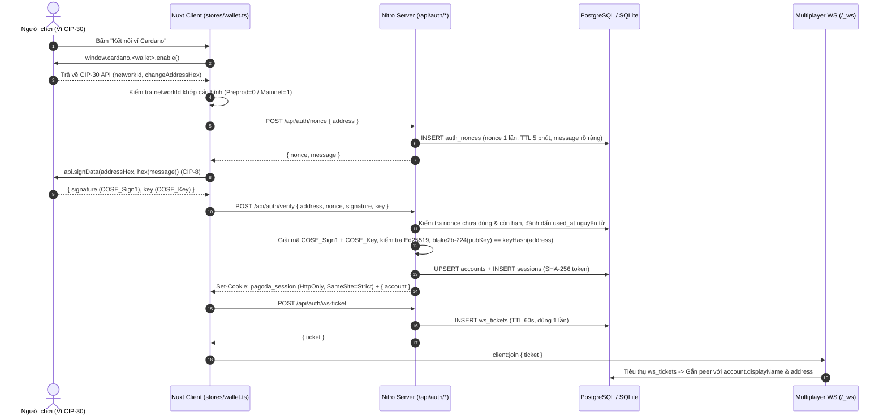
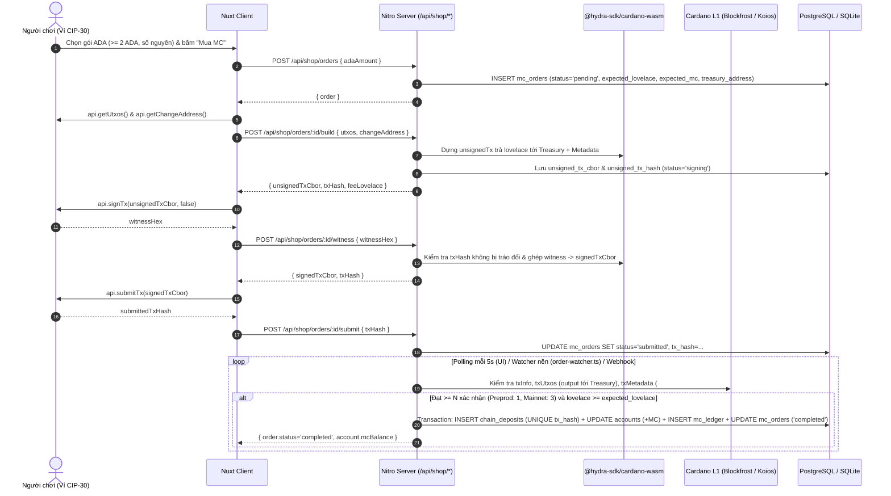
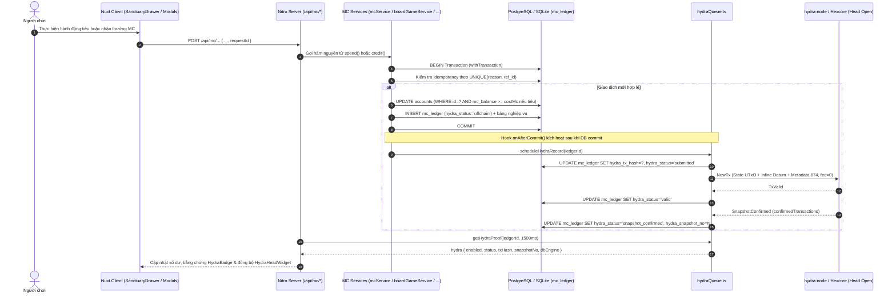

# Kiến trúc Hệ thống Vạn Cảnh Thiền Tự (`hydra-pagoda`)

Tài liệu này mô tả chính xác kiến trúc kỹ thuật hiện hành của dự án **Vạn Cảnh Thiền Tự (`hydra-pagoda`)**, bao gồm tầng cơ sở dữ liệu kép (**Supabase PostgreSQL / SQLite**), hệ thống ví **Cardano CIP-30 / CIP-8**, nền kinh tế **Merit Coins (MC)**, lớp chứng thực **Hydra Head L2 (Hexcore / hydra-node v2)**, danh mục đầy đủ API Endpoints, lược đồ cơ sở dữ liệu (15 phiên bản migration) và mô hình bảo mật.

---

## 1. Tổng quan Kiến trúc

Hệ thống tuân thủ nguyên tắc **Server-Authoritative (Máy chủ quyết định tuyệt đối)**:

- **Frontend (Nuxt 3 SPA, `ssr: false` + Vue 3 + Pinia + Three.js + Tailwind CSS v4):**
  - Không gian 3D WebGL (`lib/world3d/`) gồm Đại Hùng Bảo Điện, 500 bồ đoàn thiền, Nhà Hầu Đồng (Điện Tứ Phủ), Kỳ Đài Dưới Bóng Cây Đa, Hồ Sen Cá Koi & Vườn Thiền, Đường lên núi Parkour và đồng tu đa người chơi thời gian thực (`/_ws`).
  - Giao diện tuân thủ hệ thiết kế **Sơn mài và vàng thếp** (`DESIGN.md`, nền `#100e0c`, thẻ `#1a1714`, viền chỉ `#332d26`, vàng thếp `#c9a24b`, son ấn `#b8372b`), tích hợp thanh theo dõi **Hydra Head L2** (`components/HydraHeadWidget.vue`) và huy hiệu chứng thực (`components/HydraBadge.vue`).
  - Chỉ giao tiếp với ví trình duyệt Cardano (Eternl, Lace, Vespr, Nami...) qua chuẩn **CIP-30** (`enable`, `signData`, `getUtxos`, `signTx`, `submitTx`) và hiển thị dữ liệu do máy chủ xác nhận. Client **không bao giờ** tự cộng/trừ MC, không quyết định giá vật phẩm hay tự sinh kết quả quẻ bói.
- **Backend (Nitro / Node.js):**
  - **Xác thực ví CIP-8 (`server/utils/wallet/auth.ts`, `cose.ts`):** Xác minh chữ ký `COSE_Sign1` / Ed25519 khớp với `paymentKeyHash` của địa chỉ ví, cấp phiên qua cookie `pagoda_session` (`HttpOnly; SameSite=Strict`).
  - **Giao dịch Cardano L1 (`@hydra-sdk/cardano-wasm` + `@hydra-sdk/core`):** Dựng `unsignedTx` nạp ADA kèm Metadata `#8181`, ghép `Vkeywitnesses` phía server và đối chiếu xác nhận chuỗi qua **Blockfrost REST API** (tự động fallback sang **Koios Public REST API** khi chưa cấu hình `NUXT_BLOCKFROST_API_KEY`).
  - **Lớp Cơ sở dữ liệu thống nhất (`server/utils/wallet/db.ts`):** Hỗ trợ kép giữa **PostgreSQL (Supabase Pooler)** khi có `DATABASE_URL` / `NUXT_DATABASE_URL`, và tự động fallback sang **SQLite (`node:sqlite`, chế độ WAL)** tại `.data/pagoda.sqlite` khi chạy cục bộ. Mọi thay đổi số dư MC đều bọc trong `withTransaction` nguyên tử kèm hook `onAfterCommit`.
  - **Lớp Chứng thực Hydra L2 (`server/utils/hydra/*`):** Kết nối WebSocket & HTTP REST tới **Hexcore** (`hydra-node v2.x`) hoặc node cục bộ. Sau khi bút toán `mc_ledger` commit thành công ở CSDL, hàng đợi nền `hydraQueue.ts` tự động đóng gói thành giao dịch **Cardano Conway-era (`NewTx`)** với **State UTxO + Inline Datum** và **Metadata CIP-20 (nhãn `674`)**, phí gas bằng `0`.
  - **NPC Thầy Trụ Trì (`server/api/npc/abbot/*`):** Hỏi đáp Phật pháp và văn hóa chùa qua Google Gemini API (`NUXT_ABBOT_LLM_API_KEY`) kết hợp chế độ RAG ngoại tuyến khi không có khóa API.

---

## 2. Sơ đồ Luồng Dữ liệu (Mermaid)

### 2.1. Đăng nhập bằng Ví Cardano (CIP-30 / CIP-8) & Định danh WebSocket

### 2.2. Mua MC Coin bằng ADA trên Cardano L1 (`@hydra-sdk/cardano-wasm`)

### 2.3. Tiêu / Cộng MC Nguyên tử & Phản chiếu lên Hydra Head L2

---

## 3. Lược đồ Cơ sở Dữ liệu (`server/db/migrations.ts`)

Hệ thống sử dụng cùng một bộ **15 bản migration SQL** (`version: 1` đến `version: 15`). Khi kết nối **PostgreSQL (Supabase)**, hàm `toPostgresSql()` tự động chuyển `INTEGER PRIMARY KEY AUTOINCREMENT` sang `BIGSERIAL PRIMARY KEY` và `INTEGER` sang `BIGINT`. Khi chạy **SQLite**, CSDL lưu tại `.data/pagoda.sqlite` với `PRAGMA journal_mode = WAL`, `PRAGMA foreign_keys = ON`.

| Migration | Bảng | Khóa chính & Ràng buộc chính | Mục đích |
|---|---|---|---|
| `#1` | `accounts` | `id PK`, `address UNIQUE`, `CHECK (mc_balance >= 0)` | Tài khoản người chơi đã xác thực CIP-8, số dư `mc_balance`, kèm `l2_session_vkey`, `l2_address` (#4) và `fortune_name` (#10). |
| `#1` | `auth_nonces` | `nonce PK` | Nonce đăng nhập dùng 1 lần (TTL 5 phút, lưu `used_at` chống replay). |
| `#1` | `sessions` | `token_hash PK` | Phiên đăng nhập (chỉ lưu SHA-256 của cookie `pagoda_session`). |
| `#1` | `ws_tickets` | `ticket_hash PK` | Vé dùng 1 lần (TTL 60s) định danh kết nối WebSocket đa người chơi (`/_ws`). |
| `#2` | `mc_orders` | `order_id PK`, `tx_hash UNIQUE`, `CHECK (expected_lovelace >= 2000000)` | Đơn mua MC bằng ADA (`pending` -> `signing` -> `submitted` -> `confirming` -> `completed` / `underpaid` / `expired_paid` / `expired` / `failed`). |
| `#2` | `chain_deposits` | `tx_hash PK`, `CHECK (lovelace > 0)` | Chống cộng trùng tuyệt đối theo `tx_hash` L1 (`credited`, `underpaid`, `expired_paid`, `unmatched`). |
| `#2`, `#4` | `mc_ledger` | `id PK`, `UNIQUE (reason, ref_id)` | Sổ cái bất biến ghi mọi biến động `+`/`-` MC kèm `balance_after`, `hydra_tx_hash`, `hydra_snapshot_no`, `hydra_status`. |
| `#3` | `account_inventory` | `id PK`, `UNIQUE (account_id, item_id)`, `CHECK (quantity >= 1)` | Kho vật phẩm (cổ phục 9 nước, lễ vật cúng dường, thẻ bài di sản). |
| `#3`, `#8` | `fortune_records` | `id PK`, `request_id UNIQUE`, `CHECK (cost_mc >= 0)` | Lịch sử quẻ bói 6 môn & Tơ Duyên cặp đôi sinh tại server (hỗ trợ lượt miễn phí, lễ phẩm và MC). |
| `#3` | `merit_donations` | `id PK`, `request_id UNIQUE`, `CHECK (amount_mc > 0)` | Sổ vàng Hòm Công Đức và vật phẩm tri ân (`reward_item_id`). |
| `#4` | `hydra_kv` | `k PK` | Kho key-value lưu bí mật dẫn xuất khóa phiên Hydra nếu server tự sinh. |
| `#5` | `meditation_sessions` | `id PK`, `session_token UNIQUE` | Phiên Tọa Thiền 432Hz do server giữ đồng hồ, chống tua giờ và giới hạn hạn mức MC/ngày. |
| `#6` | `hau_dong_sessions`, `hau_dong_donations`, `hau_dong_attendance` | `session_id PK`, `request_id UNIQUE`, `UNIQUE (session_id, gia_index, account_id)` | Quản lý phiên Hầu Đồng 5 Giá (8 phút), công đức mở đàn / cộng dồn bách gia và điểm danh nhận lộc. |
| `#7` | `parkour_records`, `parkour_runs` | `UNIQUE (account_id, day_key)`, `run_token PK` | Thử thách Parkour leo núi Đỉnh Phù Vân, lượt miễn phí/trả phí và thành tích tốt nhất. |
| `#9` | `card_inventory`, `card_pack_openings` | `id PK`, `request_id UNIQUE` | Kho Thẻ Bài Di Sản 3D (độ hiếm `common`/`rare`/`epic`/`legendary`, cờ NFT CIP-68) và lịch sử mở gói Gacha. |
| `#11` | `account_streaks`, `streak_rewards` | `account_id PK`, `PK (account_id, milestone)` | Sổ Tu Tập theo chuỗi ngày giờ Việt Nam, quyền nghỉ 1 lần/tuần và phần thưởng cột mốc. |
| `#12` | `daily_deeds`, `daily_deed_rewards` | `PK (account_id, day_key, deed_id)` | Ba Việc Lành mỗi ngày và quà hoàn thành 1 lần/ngày. |
| `#13` | `onboarding_rewards` | `account_id PK` | Quà chào mừng hoàn thành hướng dẫn 5 phút đầu (tối đa 1 lần/tài khoản). |
| `#14` | `koi_state`, `koi_daily_free_feeds`, `garden_plots` | `PK (account_id, koi_index)`, `PK (account_id, plot_index)` | Chăm sóc 5 cá Koi Hồ Sen (cho ăn, đặt tên, lên cấp) và Vườn Thiền 6 ô đất trồng sen/trúc/bồ đề. |
| `#15` | `board_game_runs`, `board_game_wins`, `board_game_bonus` | `run_token PK`, `PK (account_id, day_key, game_id)` | Kỳ Đài Dưới Bóng Cây Đa (5 môn cờ: Cờ Tướng, Ô Ăn Quan, Cờ Caro, Cờ Vua, Cờ Vây; thưởng `+10 MC`/môn/ngày + `+10 MC` thưởng đủ 5 môn). |

---

## 4. Danh mục API Endpoints

### 4.1. Xác thực Ví & Hồ sơ (`/api/auth/*`)

| Phương thức & Đường dẫn | Chức năng chính |
|---|---|
| `POST /api/auth/nonce` | Phát hành nonce ngẫu nhiên dùng 1 lần (TTL 5 phút) kèm thông điệp ký CIP-8. |
| `POST /api/auth/verify` | Xác minh chữ ký `COSE_Sign1`, tạo/cập nhật tài khoản và gắn cookie phiên `pagoda_session`. |
| `GET /api/auth/me` | Kiểm tra phiên hiện tại và trả về thông tin tài khoản, số dư MC, mạng Cardano. |
| `POST /api/auth/logout` | Xóa phiên trong CSDL và hủy cookie `pagoda_session`. |
| `POST /api/auth/ws-ticket` | Cấp vé dùng 1 lần (TTL 60s) để định danh người chơi khi kết nối WebSocket `/_ws`. |
| `POST /api/auth/profile-name` | Đồng bộ họ tên từ hồ sơ Bói Quẻ vào `accounts.fortune_name` để hiển thị trong không gian 3D. |

### 4.2. Mua MC Coin bằng ADA trên Cardano L1 (`/api/shop/*`)

| Phương thức & Đường dẫn | Chức năng chính |
|---|---|
| `GET /api/shop/orders` | Lấy danh sách đơn mua MC, lịch sử nạp L1 (`chain_deposits`) và sổ cái của tài khoản. |
| `POST /api/shop/orders` | Tạo đơn nạp ADA mới (`>= 2 ADA`, số nguyên, tỉ lệ `1 ADA = 1.000 MC`). |
| `POST /api/shop/orders/:id/build` | Dựng giao dịch L1 chưa ký (`unsignedTxCbor`) kèm Metadata `#8181` bằng `@hydra-sdk/cardano-wasm`. |
| `POST /api/shop/orders/:id/witness` | Kiểm tra khớp `txHash` và ghép `Vkeywitnesses` từ ví CIP-30 thành `signedTxCbor`. |
| `POST /api/shop/orders/:id/submit` | Ghi nhận `txHash` sau khi ví gửi lên chuỗi và kiểm tra trạng thái xác nhận ban đầu. |
| `GET /api/shop/orders/:id` | Tra cứu trạng thái đơn hàng và tự động đối soát chuỗi nếu đơn đang chờ xác nhận. |
| `POST /api/shop/webhook/blockfrost` | Tiếp nhận webhook từ Blockfrost để cộng MC ngay khi giao dịch L1 đạt đủ xác nhận. |

### 4.3. Kinh tế MC Coin & Gameplay (`/api/mc/*`)

| Nhóm nghiệp vụ | Endpoints | Ghi chú chứng thực Hydra L2 |
|---|---|---|
| **Danh mục & Cửa hàng** | `GET /api/mc/catalog`, `POST /api/mc/shop/buy` | `shop/buy` trừ MC nguyên tử và trả về bằng chứng `hydra`. |
| **Bói Quẻ & Tơ Duyên** | `POST /api/mc/fortune/draw`, `POST /api/mc/fortune/draw-couple` | Sinh quẻ tất định theo seed ngày; mọi lượt dùng MC trả về `hydra`. |
| **Hòm Công Đức & Lễ vật** | `POST /api/mc/merit/donate`, `POST /api/mc/incense/offer`, `POST /api/mc/lantern/release` | Công đức và dâng hương trả về bằng chứng `hydra`. |
| **Thẻ Bài Di Sản & Gacha** | `GET /api/mc/cards/inventory`, `POST /api/mc/cards/pack-buy` | Mở gói thẻ Gacha trừ MC nguyên tử và trả về `hydra`. |
| **Hội Thiền 432Hz** | `GET /api/mc/meditation/status`, `POST /api/mc/meditation/{start,complete,cancel,group-bonus}` | `complete` và `group-bonus` cộng MC thưởng có kiểm soát hạn mức ngày và ghi L2. |
| **Nhà Hầu Đồng (Tứ Phủ)** | `GET /api/mc/hau-dong/status`, `POST /api/mc/hau-dong/{donate,heartbeat,claim}` | `donate` và `claim` ghi bút toán MC và trả về `hydra`. |
| **Leo núi Parkour** | `GET /api/mc/parkour/status`, `POST /api/mc/parkour/{start,complete}` | Lượt trả phí (`start`) và phần thưởng (`complete`) ghi sổ cái và trả về `hydra`. |
| **Kỳ Đài Dưới Bóng Cây Đa** | `GET /api/mc/games/status`, `POST /api/mc/games/{start,win}` | 5 trò cờ dân gian; `win` kiểm tra thời gian chơi tối thiểu, cộng thưởng MC và trả về `hydra`. |
| **Hồ Sen Cá Koi & Vườn Thiền** | `GET /api/mc/koi/status`, `POST /api/mc/koi/{feed,rename}`, `GET /api/mc/garden/status`, `POST /api/mc/garden/{plant,water,harvest}` | Cho ăn cá Koi, trồng/tưới/thu hoạch cây thiền đồng bộ nguyên tử với kho đồ và MC. |
| **Sổ Tu Tập, Việc Lành & Hướng dẫn** | `GET /api/mc/streak/status`, `POST /api/mc/streak/claim`, `GET /api/mc/deeds/status`, `POST /api/mc/deeds/{visit,claim}`, `GET /api/mc/onboarding/status`, `POST /api/mc/onboarding/complete` | Duy trì chuỗi tu tập theo giờ Việt Nam và phát quà cột mốc idempotent. |

### 4.4. Hydra L2 & NPC Thầy Trụ Trì

| Phương thức & Đường dẫn | Chức năng chính |
|---|---|
| `GET /api/hydra/status` | Trả về trạng thái kết nối Head (`Open`/`Initializing`/`Closed`/`Disconnected`), `headId`, `dbEngine` (`postgres`/`sqlite`), `network`, `headUtxoCount`, `fuelUtxoCount`, `adaLockedLovelace`, `adaLocked`, `avgConfirmMs`, `fuelAddress`, `recentTxs` (kèm CIP-20 metadata, độ trễ từng tx) và thống kê `ledger`. |
| `POST /api/npc/abbot/greet`, `POST /api/npc/abbot/ask` | Chào hỏi và vấn đáp với NPC Thầy Trụ Trì (Gemini LLM + RAG Phật học/văn hóa chùa). |

---

## 5. Mô hình Mối đe dọa (Threat Model) & Cơ chế Phòng vệ

| # | Mối đe dọa / Kịch bản tấn công | Cơ chế phòng vệ trong `hydra-pagoda` |
|---|---|---|
| 1 | **Giả mạo địa chỉ ví khi đăng nhập** | Bắt buộc xác thực chữ ký **CIP-8 (`COSE_Sign1`)** bằng Ed25519, đối chiếu `blake2b_224(publicKey) === paymentKeyHash(address)` và kiểm tra header bảo vệ COSE (`cose.ts`). |
| 2 | **Phát lại (Replay Attack) chữ ký đăng nhập** | Nonce ngẫu nhiên 128-bit gắn chặt với `address` và `domain`, TTL 5 phút, đánh dấu `used_at` nguyên tử ngay lần `verify` đầu tiên (`WHERE nonce = ? AND used_at IS NULL`). |
| 3 | **Đánh cắp token phiên qua XSS / `localStorage`** | Không lưu token xác thực ở `localStorage`. Phiên giữ trong cookie `HttpOnly; SameSite=Strict`; CSDL chỉ lưu băm `SHA-256(token)`. |
| 4 | **Tấn công CSRF từ tên miền khác** | Mọi endpoint `POST` thay đổi trạng thái đều gọi `assertSameOrigin(event)` đối chiếu `Origin` với `Host`. |
| 5 | **Giả mạo danh tính trên WebSocket `/_ws`** | Bắt buộc dùng vé 1 lần `ws_tickets` (TTL 60s). Server gán `peer.id` và tên hiển thị từ tài khoản đã xác thực, bỏ qua tên do client gửi trong gói tin realtime. |
| 6 | **Tráo đổi giao dịch L1 trước khi ký CIP-30** | Server lưu `unsigned_tx_cbor` và `unsigned_tx_hash` khi build; khi nhận `witnessHex` sẽ kiểm tra khớp `txHash` và chỉ ghép `Vkeywitnesses` vào đúng `TransactionBody` gốc. |
| 7 | **Cộng trùng MC khi Webhook / Polling gọi lặp** | `chain_deposits` khóa `tx_hash PRIMARY KEY` (`ON CONFLICT DO NOTHING`) và `mc_ledger` khóa `UNIQUE(reason, ref_id)` trong cùng transaction. |
| 8 | **Chuyển thiếu ADA (`Underpaid`)** | Đối chiếu tổng lovelace thực nhận tại các output trả về đúng `treasuryAddress` từ Blockfrost/Koios; nếu `< expected_lovelace` đánh dấu `underpaid` và cộng `0 MC`. |
| 9 | **Đua luồng (Race Condition) làm âm số dư MC** | `spend()` chạy trong `withTransaction` và dùng `UPDATE accounts SET mc_balance = mc_balance - ? WHERE id = ? AND mc_balance >= ?` kết hợp ràng buộc `CHECK (mc_balance >= 0)`. |
| 10 | **Gửi lặp yêu cầu tiêu MC (Double Spend)** | Client sinh `requestId` cố định cho mỗi thao tác; `UNIQUE(reason, ref_id)` trên `mc_ledger` trả lại kết quả cũ (`idempotentReplay: true`) mà không trừ tiền lần hai. |
| 11 | **Lộ khóa riêng L2 / khóa Fuel** | Khóa Fuel và Session Key dẫn xuất tất định trên server bằng `HMAC-SHA256(serverSecret, label)`. Khóa riêng không rời server và không lưu trong DB; chỉ lưu `l2_session_vkey` và `l2_address`. |
| 12 | **Hydra Head tắt hoặc mất kết nối làm treo game** | CSDL (PostgreSQL/SQLite) luôn commit trước. Ghi L2 chạy bất đồng bộ sau commit qua `onAfterCommit()`; mọi lỗi L2 chỉ giữ bút toán ở `offchain` và không chặn gameplay. |
| 13 | **Tranh chấp UTxO (`BadInputsUTxO`) trên Hydra L2** | Hàng đợi tuần tự theo từng tài khoản cho State UTxO, kết hợp **Fuel Pool** (tự động tách thành 10 UTxO nhỏ) để nhiều tài khoản ghi song song; gặp `hydra_tx_invalid` tự nạp lại UTxO và thử lại. |
| 14 | **Tua giờ trình duyệt để gian lận Thiền / Cờ / Parkour** | Server cấp `session_token` / `run_token` kèm `started_at` phía máy chủ, kiểm tra thời gian thực tối thiểu và giới hạn phần thưởng theo ngày Việt Nam (`lib/time/vietnamDay.ts`). |

---

## 6. Kiến trúc Hybrid Hydra L2 & Tích hợp Hexcore

Chi tiết từng bước vận hành và nạp Fuel UTxO xem thêm tại [docs/HYDRA-L2.md](./HYDRA-L2.md).

### 6.1. Mô hình UTxO & Giao dịch L2 (`l2TxBuilder.ts`)

- **Fuel Pool (`fuelKey`):** Khóa Fuel dẫn xuất từ `NUXT_HYDRA_SESSION_SECRET` (nhãn `hydra-pagoda:l2-fuel:v1`). Người vận hành nạp tADA từ Cardano Preprod L1 vào Head bằng lệnh `npm run hydra:commit` (`scripts/hydra-commit-fuel.mjs`). Ngay ở giao dịch đầu tiên, `hydraQueue.ts` tự động tách UTxO Fuel lớn nhất thành `NUXT_HYDRA_FUEL_TARGET` (mặc định 10) UTxO nhỏ để xử lý song song.
- **State UTxO (`sessionKey`):** Mỗi tài khoản có 1 địa chỉ Enterprise L2 riêng (`l2_address`). Mỗi giao dịch L2 tiêu State UTxO cũ (nếu có) + 1 Fuel UTxO, sinh ra:
  - **Output #0 (State UTxO mới):** Khóa `NUXT_HYDRA_STATE_LOVELACE` (mặc định 2 ADA) kèm **Plutus Inline Datum** `Constr 0 [balanceAfter, ledgerId, deltaMc, accountId]`.
  - **Output #1 (Fuel Change):** Hoàn phần lovelace dư về lại địa chỉ Fuel để tái sử dụng.
  - **Phí giao dịch:** `0 lovelace`.
  - **Metadata CIP-20 (nhãn `674`):** Đính kèm `Action`, `Account` (ví L1) và `Receipt` (`mc_<reason>_<refId>`).

### 6.2. Tương thích Hexcore & `hydra-node v2.x`

- **Cấu hình động không cần khởi động lại:** `server/utils/hydra/config.ts` theo dõi `mtime` của file `.env` (`readLiveDotEnv()`), cho phép bật/tắt `HYDRA_L2_ENABLED` hoặc đổi `HYDRA_NODE_WS_URL` tức thời; khi tắt sẽ gọi `stopHydraClient()` đóng WebSocket ngay lập tức.
- **Định tuyến Hexcore Proxy:** WebSocket chạy tại `wss://<host>/api/heads/<id>/nodes/<n>/socket?X-Api-Key=<token>`, còn các lệnh HTTP REST (`/commit`, `/snapshot/utxo`, `/head`) chạy ngay dưới hậu tố `/socket/...` kèm header `X-Api-Key`.
- **Tương thích bản tin Hydra v2.4+:** `hydraClient.ts` đọc trực tiếp `snapshotUtxo` từ `Greetings` / `HeadIsOpen` / `SnapshotConfirmed` trong `0ms` (tránh timeout `GetUTxO` vốn đã bị loại bỏ trên Hydra v2), hỗ trợ cả `snapshot.confirmedTransactions` lẫn `snapshot.confirmed`, và bắt đủ các sự kiện Incremental Deposit (`CommitRecorded`, `CommitApproved`, `CommitFinalized`, `DepositRecorded`, `DepositApproved`, `DepositFinalized`).

### 6.3. Thành phần mã nguồn Hydra L2

| Tệp | Vai trò |
|---|---|
| `server/utils/hydra/config.ts` | Đọc cấu hình Hydra L2 trực tiếp từ `.env`, `process.env` và `runtimeConfig`. |
| `server/utils/hydra/hydraClient.ts` | Client WebSocket/HTTP tới `hydra-node`/Hexcore, tự reconnect, lưu cache `snapshotUtxo`, đo độ trễ từng giao dịch (`confirmLatencyOf`). |
| `server/utils/hydra/sessionKey.ts` | Dẫn xuất khóa Fuel và khóa phiên L2 theo tài khoản. |
| `server/utils/hydra/l2TxBuilder.ts` | Dựng và ký giao dịch Conway-era L2 (State UTxO + Inline Datum, Metadata CIP-20 nhãn 674, tách Fuel Pool). |
| `server/utils/hydra/hydraQueue.ts` | Hàng đợi tuần tự theo tài khoản, quản lý Fuel Pool, chạy sau commit (`onAfterCommit`) và cập nhật `mc_ledger`. |
| `server/plugins/hydra-l2.ts` | Plugin Nitro tự động khởi động kết nối Hydra client cùng máy chủ. |
| `server/api/hydra/status.get.ts` | API trạng thái Head, tổng UTxO, tổng ADA khóa và 25 giao dịch L2 gần nhất kèm bằng chứng. |
| `scripts/hydra-commit-fuel.mjs` | Script `npm run hydra:commit` tự động kiểm tra trạng thái Head, dựng/ký giao dịch Commit bằng khóa Fuel và gửi lên Cardano L1 qua Blockfrost. |
| `stores/hydra.ts`, `components/HydraBadge.vue`, `components/HydraHeadWidget.vue` | Lưu trạng thái L2, đồng bộ tức thời sau mỗi giao dịch MC, hiển thị huy hiệu trên thẻ kết quả và bảng theo dõi + kiểm chứng giao dịch L2 ở mép phải màn hình 3D. |
