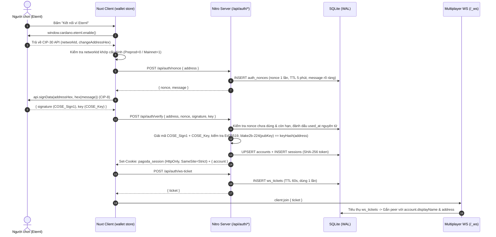
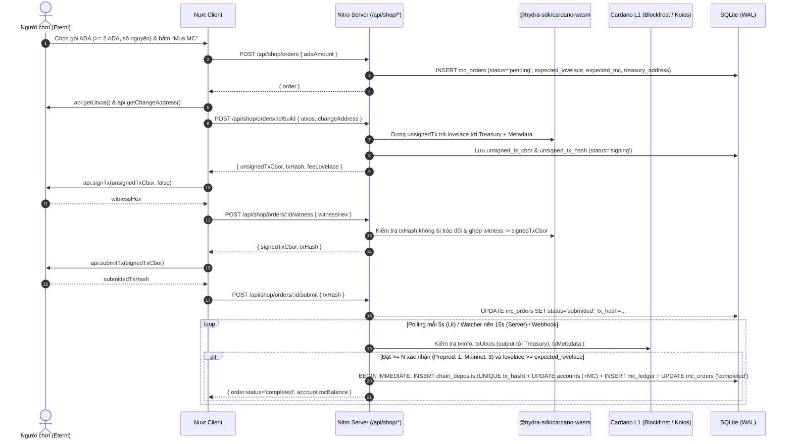
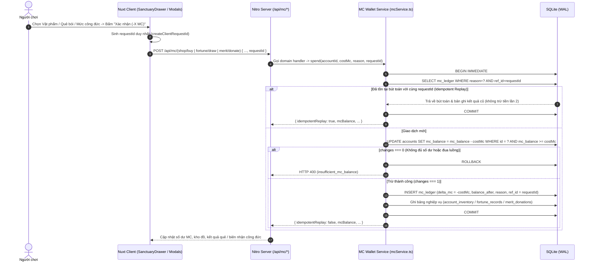
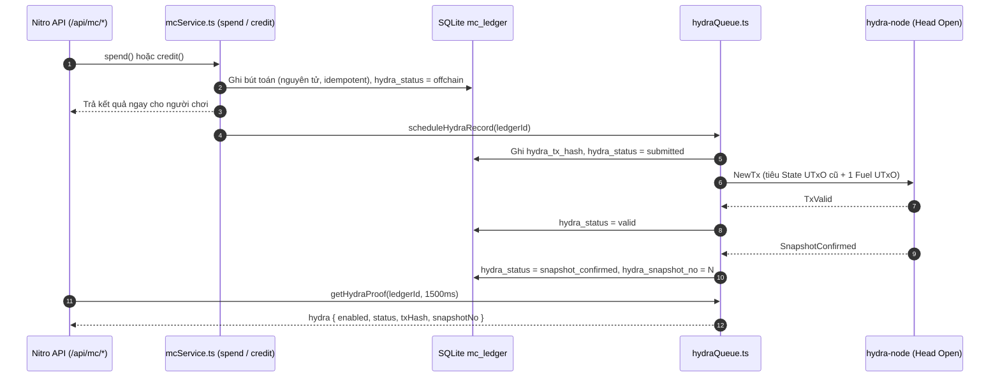

# Kiến trúc Hệ thống Ví Cardano Eternl & Kinh tế MC Coin (`KIEN_TRUC.md`)

Tài liệu này mô tả chi tiết kiến trúc kỹ thuật, sơ đồ luồng dữ liệu, lược đồ cơ sở dữ liệu SQLite, danh sách API và mô hình bảo mật của hệ thống Ví Cardano Eternl & MC Coin trong dự án **Vạn Cảnh Thiền Tự (`hydra-pagoda`)**.

---

## 1. Tổng quan Kiến trúc

Hệ thống tuân thủ nguyên tắc **Server-Authoritative (Máy chủ quyết định tuyệt đối)**:
- **Client (Nuxt 3 SPA + Vue 3 + Pinia)**: chỉ giao tiếp với ví trình duyệt Eternl qua chuẩn **CIP-30** (`enable`, `signData`, `getUtxos`, `signTx`, `submitTx`) và hiển thị trạng thái từ server trả về. Client **không bao giờ** tự cộng/trừ số dư MC, không quyết định giá vật phẩm và không tự sinh kết quả quẻ bói.
- **Server (Nitro / Node.js)**:
  - Xác thực chủ sở hữu địa chỉ ví bằng chữ ký số **CIP-8 (`COSE_Sign1` / Ed25519)** và cấp phiên qua cookie `httpOnly; SameSite=Strict`.
  - Dựng giao dịch Cardano L1 và ghép witness bằng **`@hydra-sdk/cardano-wasm`** + **`@hydra-sdk/core`**.
  - Theo dõi giao dịch trên chuỗi qua **Blockfrost REST API** (hoặc tự động chuyển sang **Koios Public REST API v1** khi không cấu hình `NUXT_BLOCKFROST_API_KEY`).
  - Lưu trữ toàn bộ tài khoản, đơn nạp, giao dịch trên chuỗi, sổ cái bất biến (`mc_ledger`), kho đồ (`account_inventory`), lịch sử quẻ (`fortune_records`) và công đức (`merit_donations`) trong **SQLite (chế độ WAL)** với giao dịch nguyên tử (`BEGIN IMMEDIATE`).

---

## 2. Sơ đồ Luồng Dữ liệu (Mermaid)

### 2.1. Nghiệp vụ 1: Đăng nhập bằng Ví Eternl (CIP-30 / CIP-8) & Định danh WebSocket

### 2.2. Nghiệp vụ 2: Mua MC Coin bằng ADA (`@hydra-sdk/cardano-wasm` & Chain Indexer)

### 2.3. Nghiệp vụ 3: Tiêu MC Coin Nguyên tử (`spend()`)

---

## 3. Lược đồ Cơ sở Dữ liệu SQLite (`server/db/migrations.ts`)

CSDL mặc định lưu tại `.data/pagoda.sqlite` với `PRAGMA journal_mode = WAL`, `PRAGMA foreign_keys = ON`, `PRAGMA synchronous = NORMAL`.

| # | Bảng | Khóa chính & Ràng buộc | Mục đích |
|---|---|---|---|
| 1 | `schema_migrations` | `version PRIMARY KEY` | Lưu lịch sử các bản migration SQL đã chạy (#1 → #4, trong đó #4 là migration Hybrid Hydra L2, xem mục 6.2). |
| 2 | `accounts` | `id PRIMARY KEY AUTOINCREMENT`, `address UNIQUE`, `CHECK (mc_balance >= 0)` | Tài khoản người chơi theo địa chỉ bech32 đã xác thực CIP-8 và số dư `mc_balance` nguyên. |
| 3 | `auth_nonces` | `nonce PRIMARY KEY` | Nonce đăng nhập dùng 1 lần (hết hạn sau 5 phút, lưu `used_at` chống replay). |
| 4 | `sessions` | `token_hash PRIMARY KEY` | Phiên đăng nhập (chỉ lưu băm SHA-256 của cookie `pagoda_session`). |
| 5 | `ws_tickets` | `ticket_hash PRIMARY KEY` | Vé một lần (TTL 60 giây) để gắn kết nối WebSocket đa người chơi với tài khoản thật. |
| 6 | `mc_orders` | `order_id PRIMARY KEY`, `tx_hash UNIQUE`, `CHECK (expected_lovelace >= 2000000)` | Đơn mua MC bằng ADA (`pending` → `signing` → `submitted` → `confirming` → `completed` / `underpaid` / `expired_paid` / `expired`). |
| 7 | `chain_deposits` | `tx_hash PRIMARY KEY`, `CHECK (lovelace > 0)` | Bảng chống cộng trùng tuyệt đối theo `tx_hash` trên chuỗi Cardano (`credited`, `underpaid`, `expired_paid`, `unmatched`). |
| 8 | `mc_ledger` | `id PRIMARY KEY AUTOINCREMENT`, `UNIQUE (reason, ref_id)` | Sổ cái bất biến (append-only) ghi mọi biến động `+` / `-` MC kèm `balance_after` và `metadata_json`. |
| 9 | `account_inventory` | `PRIMARY KEY (account_id, item_id)`, `CHECK (quantity >= 1)` | Kho vật phẩm của từng tài khoản (cổ phục, lễ vật cúng dường, thẻ bài di sản 3D). |
| 10 | `fortune_records` | `id PRIMARY KEY AUTOINCREMENT`, `request_id UNIQUE` | Lịch sử quẻ bói được sinh tại server của người chơi. |
| 11 | `merit_donations` | `id PRIMARY KEY AUTOINCREMENT`, `request_id UNIQUE`, `CHECK (amount_mc > 0)` | Sổ vàng công đức và vật phẩm tri ân (`reward_item_id`). |

---

## 4. Danh mục API Endpoints

### 4.1. Nhóm Xác thực Ví Eternl (`/api/auth/*`)

| Phương thức & Đường dẫn | Đầu vào (Body) | Đầu ra (200 OK) | Mã lỗi chính |
|---|---|---|---|
| `POST /api/auth/nonce` | `{ address: string }` (hex hoặc bech32) | `{ nonce, address, message, expiresAt, network }` | `400 invalid_address`, `400 wrong_network`, `403 bad_origin`, `429 rate_limited` |
| `POST /api/auth/verify` | `{ address, nonce, signature, key }` | `{ authenticated: true, network, account }` + Cookie `pagoda_session` | `400 missing_fields`, `401 invalid_or_expired_nonce`, `401 signature_invalid`, `429 rate_limited` |
| `GET /api/auth/me` | *(Cookie `pagoda_session`)* | `{ authenticated: boolean, network, account: Account \| null }` | `200` (trả `authenticated: false` nếu chưa đăng nhập) |
| `POST /api/auth/logout` | *(Cookie `pagoda_session`)* | `{ ok: true }` (xóa session DB + xóa cookie) | `403 bad_origin` |
| `POST /api/auth/ws-ticket` | *(Cookie `pagoda_session`)* | `{ ticket: string, expiresInSeconds: 60 }` | `401 unauthenticated`, `403 bad_origin` |

### 4.2. Nhóm Mua MC Coin bằng ADA (`/api/shop/*`)

| Phương thức & Đường dẫn | Đầu vào | Đầu ra (200 OK) | Mã lỗi chính |
|---|---|---|---|
| `GET /api/shop/orders` | *(Cookie `pagoda_session`)* | `{ network, rate, account, orders, deposits, ledger }` | `401 unauthenticated` |
| `POST /api/shop/orders` | `{ adaAmount: number }` (nguyên `>= 2`) | `{ order: OrderDto }` | `400 invalid_amount`, `400 below_minimum`, `401 unauthenticated`, `503 treasury_not_configured` |
| `POST /api/shop/orders/:id/build` | `{ utxos: string[], changeAddress?: string }` | `{ orderId, unsignedTxCbor, txHash, feeLovelace, expectedLovelace, treasuryAddress }` | `400 invalid_utxos`, `400 insufficient_funds`, `404 order_not_found`, `409 order_not_payable` |
| `POST /api/shop/orders/:id/witness` | `{ witnessHex: string }` | `{ orderId, signedTxCbor, txHash }` | `400 invalid_witness_cbor`, `400 tx_hash_mismatch`, `400 missing_vkey_witness` |
| `POST /api/shop/orders/:id/submit` | `{ txHash: string }` | `{ order, settlement, account }` | `400 invalid_tx_hash`, `409 tx_hash_conflict` |
| `GET /api/shop/orders/:id` | *(Cookie `pagoda_session`)* | `{ order, account }` (tự động kiểm tra chuỗi nếu đơn đang chờ) | `404 order_not_found` |
| `POST /api/shop/webhook/blockfrost` | Payload webhook Blockfrost hoặc `{ txHash }` | `{ ok: true, processed: number, results: [...] }` | `401 invalid_webhook_secret` |

### 4.3. Nhóm Tiêu MC Coin (`/api/mc/*`)

| Phương thức & Đường dẫn | Đầu vào | Đầu ra (200 OK) | Mã lỗi chính |
|---|---|---|---|
| `GET /api/mc/catalog` | *(Tùy chọn Cookie `pagoda_session`)* | `{ authenticated, account, services, shopCatalog, fortuneTiers, meritConfig, globalMeritTotal, leaderboard, inventory, fortuneHistory, ledgerHistory }` | `200` |
| `POST /api/mc/shop/buy` | `{ itemId: string, requestId: string }` | `{ ok: true, idempotentReplay, ledgerId, spentMc, mcBalance, item, quantity, inventory }` | `400 invalid_item`, `400 already_owned`, `400 insufficient_mc_balance`, `401 unauthenticated` |
| `POST /api/mc/fortune/draw` | `{ category, tier, requestId }` | `{ ok: true, idempotentReplay, ledgerId, spentMc, mcBalance, fortune, receiptHash }` | `400 invalid_category`, `400 invalid_tier`, `400 insufficient_mc_balance`, `401 unauthenticated` |
| `POST /api/mc/merit/donate` | `{ amountMc: number, prayer: string, requestId: string }` | `{ ok: true, idempotentReplay, ledgerId, spentMc, mcBalance, donation, globalMeritTotal, leaderboard, inventory }` | `400 invalid_amount`, `400 insufficient_mc_balance`, `401 unauthenticated` |

---

## 5. Mô hình Mối đe dọa (Threat Model) & Cơ chế Phòng vệ

| # | Mối đe dọa / Kịch bản tấn công | Cơ chế phòng vệ trong `hydra-pagoda` |
|---|---|---|
| 1 | **Giả mạo địa chỉ ví khi đăng nhập** (Client gửi địa chỉ của người khác lên server) | Server bắt buộc xác thực chữ ký **CIP-8 (`COSE_Sign1`)** bằng Ed25519, kiểm tra `blake2b_224(publicKey) === paymentKeyHash(address)` và kiểm tra `address` trong header bảo vệ của COSE (`cose.ts`). |
| 2 | **Tấn công phát lại (Replay Attack) chữ ký đăng nhập** | Nonce sinh ngẫu nhiên 128-bit, gắn chặt với `address` và `domain`, hết hạn sau 5 phút, và bị đánh dấu `used_at` nguyên tử ngay lần `verify` đầu tiên (`WHERE nonce = ? AND used_at IS NULL`). |
| 3 | **Đánh cắp token phiên qua XSS / `localStorage`** | Không lưu bất kỳ token xác thực nào trong `localStorage`. Phiên được giữ trong cookie `HttpOnly; SameSite=Strict` và trong DB chỉ lưu băm `SHA-256(token)`. |
| 4 | **Tấn công CSRF từ trang web khác** | Mọi endpoint thay đổi trạng thái (`POST`) đều gọi `assertSameOrigin(event)` kiểm tra header `Origin` khớp với `Host` của server. |
| 5 | **Giả mạo danh tính hoặc tên người chơi trên WebSocket** | Kết nối WebSocket dùng vé một lần `ws_tickets` (TTL 60s). Server tự gán `peer.id` và tên hiển thị từ tài khoản đã xác thực, bỏ qua mọi `id`/`name` do client tự truyền trong gói `move`, `chat`, `emote`. |
| 6 | **Tráo đổi giao dịch (Tx Tampering) trước khi gửi chữ ký CIP-30** | Server lưu `unsigned_tx_cbor` và `unsigned_tx_hash` lúc dựng giao dịch. Khi nhận `witnessHex`, server kiểm tra `txHash` và chỉ ghép `Vkeywitnesses` vào đúng `TransactionBody` mà server đã dựng. |
| 7 | **Cộng trùng MC khi Webhook / Polling gọi lặp cùng `txHash`** | Bảng `chain_deposits` có `tx_hash PRIMARY KEY` (`INSERT ... ON CONFLICT(tx_hash) DO NOTHING`) và bảng `mc_ledger` có `UNIQUE(reason, ref_id)` bên trong cùng một transaction `BEGIN IMMEDIATE`. |
| 8 | **Khai khống số ADA hoặc chuyển thiếu ADA (`Underpaid`)** | Server đọc số lovelace thực nhận tại các UTxO đầu ra trả về đúng `treasuryAddress` từ Blockfrost/Koios. Nếu `< expected_lovelace`, đơn bị đánh dấu `underpaid` và cộng `0 MC`. |
| 9 | **Đua luồng (Race Condition) bấm mua/tiêu MC nhiều lần cùng lúc để làm âm số dư** | Hàm `spend()` chạy trong `BEGIN IMMEDIATE` và dùng `UPDATE accounts SET mc_balance = mc_balance - ? WHERE id = ? AND mc_balance >= ?` kết hợp `CHECK (mc_balance >= 0)`. Đã kiểm chứng bắn đồng thời 10 luồng trong `test-spend.mjs`. |
| 10 | **Gửi lặp yêu cầu tiêu MC khi mạng chập chờn (Double Spend)** | Client sinh `requestId` cố định cho mỗi lần bấm xác nhận; `mc_ledger` có `UNIQUE(reason, ref_id)` giúp trả lại kết quả cũ (`idempotentReplay: true`) mà không trừ MC lần hai. |
| 11 | **Lộ khóa riêng L2 của người chơi / khóa Fuel** | Khóa L2 được dẫn xuất trên server bằng `HMAC-SHA256(serverSecret, label)`, chỉ lưu phần công khai (`accounts.l2_session_vkey`, `accounts.l2_address`). Khóa riêng không rời server và không lưu vào DB. Cần bảo vệ `NUXT_HYDRA_SESSION_SECRET` như một khóa quan trọng. |
| 12 | **Hydra Head lỗi / hydra-node tắt làm treo gameplay** | SQLite ghi trước và là nguồn sự thật. Việc ghi lên L2 chạy nền sau khi commit; mọi lỗi chỉ đưa bút toán về `offchain` và ghi log, không ném lỗi ra API. |
| 13 | **Hai giao dịch L2 cùng tiêu một UTxO (`BadInputsUTxO`)** | Hàng đợi tuần tự theo từng tài khoản (State UTxO) và Fuel Pool nhiều UTxO để các tài khoản khác nhau chạy song song. Gặp `hydra_tx_invalid` thì làm mới cache và thử lại 1 lần. |
| 14 | **Ghi trùng một bút toán lên L2 khi người chơi bấm lặp** | Bút toán lặp được chặn từ SQLite bằng `UNIQUE(reason, ref_id)` (trả `idempotentReplay`), nên không sinh thêm giao dịch L2 (đã kiểm thử ở ca số 6 của `test-hydra-l2.mjs`). |

---

## 6. Mở rộng: Hybrid Hydra L2 cho Sổ cái MC Coin

Chi tiết thiết kế xem `CO_CHE_MC_VA_HYDRA_L2.md` (Phần 4). Mục này chỉ tóm tắt phần kiến trúc.

### 6.1. Luồng ghi bút toán lên Hydra Head

Nếu bất kỳ bước nào ở L2 lỗi, hàng đợi đưa bút toán về `offchain` (xóa `hydra_tx_hash`) và gameplay không bị ảnh hưởng.

### 6.2. Thay đổi cơ sở dữ liệu (migration #4)

| Bảng | Thay đổi | Mục đích |
|---|---|---|
| `mc_ledger` | Thêm `hydra_tx_hash`, `hydra_snapshot_no`, `hydra_status` | Lưu bằng chứng L2 cho từng bút toán. `hydra_status` nhận một trong: `offchain`, `submitted`, `valid`, `snapshot_confirmed` |
| `accounts` | Thêm `l2_session_vkey`, `l2_address` | Khóa công khai và địa chỉ L2 (enterprise) của tài khoản |
| `hydra_kv` | Bảng mới (khóa - giá trị) | Lưu `NUXT_HYDRA_SESSION_SECRET` khi để server tự sinh |

### 6.3. API bổ sung

| Phương thức & Đường dẫn | Đầu ra | Ghi chú |
|---|---|---|
| `GET /api/hydra/status` | `{ enabled, connected, mode, headStatus, latestSnapshotNo, totalL2Txs, confirmedL2Txs, avgConfirmMs, fuelAddress, ledger }` | `mode` là `hydra_l2` hoặc `local_ledger`. Khi tắt Hydra trả `local_ledger` và `headStatus = Disconnected`. `ledger` gồm `byStatus`, `fuelPoolSize`, `inFlight` |
| `POST /api/mc/shop/buy`, `POST /api/mc/fortune/draw`, `POST /api/mc/merit/donate` | Thêm trường `hydra: { enabled, status, txHash, snapshotNo }` vào kết quả ở mục 4.3 | Chờ tối đa 1500ms để lấy bằng chứng; chưa kịp thì trả trạng thái hiện tại (ví dụ `submitted` hoặc `offchain`) |

### 6.4. Thành phần mã nguồn

| Tệp | Vai trò |
|---|---|
| `server/utils/hydra/config.ts` | Đọc cấu hình (`HYDRA_L2_ENABLED`, `HYDRA_NODE_WS_URL`, ...) |
| `server/utils/hydra/hydraClient.ts` | Client WebSocket tới hydra-node, tự kết nối lại, phát sự kiện `TxValid` / `TxInvalid` / `SnapshotConfirmed` |
| `server/utils/hydra/sessionKey.ts` | Dẫn xuất khóa Fuel và khóa phiên theo tài khoản |
| `server/utils/hydra/l2TxBuilder.ts` | Dựng và ký giao dịch L2 (State UTxO + datum, metadata CIP-20, tách Fuel) |
| `server/utils/hydra/hydraQueue.ts` | Hàng đợi tuần tự, Fuel Pool, cập nhật trạng thái vào `mc_ledger` |
| `server/plugins/hydra-l2.ts` | Khởi động client Hydra cùng server Nitro |
| `stores/hydra.ts`, `components/HydraBadge.vue` | Hiển thị chế độ sổ cái và bằng chứng trên giao diện |
