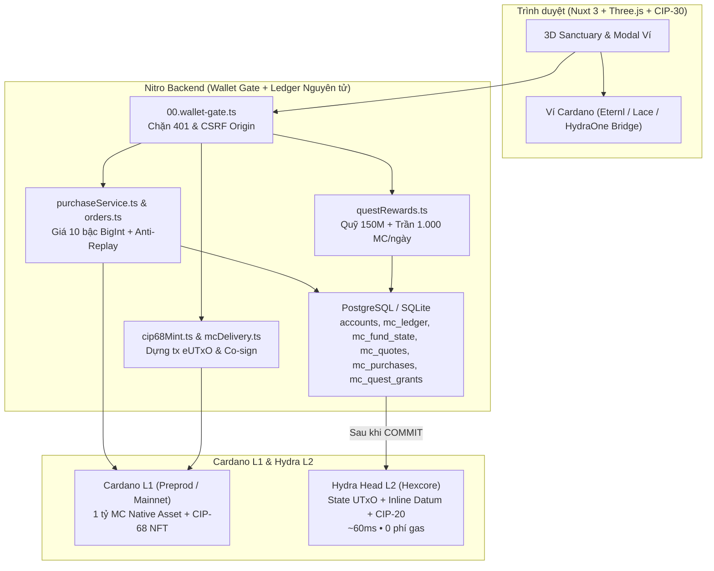
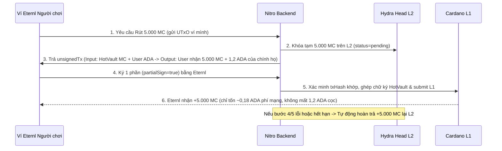

# Tài Liệu Kỹ Thuật — Kiến Trúc Cardano L1 + Hydra L2 + Wallet Gate

Tài liệu này mô tả chi tiết kiến trúc kỹ thuật đã triển khai và thiết kế mở rộng cho hệ thống **Vạn Cảnh Thiền Tự (Hydra Pagoda)**, phục vụ đánh giá chuyên môn tại Hackathon, thẩm định kỹ thuật khi gọi vốn và vận hành lên Mainnet.

---

## 1. Ngăn xếp công nghệ (Tech Stack)

- **Frontend:** Nuxt 3 (SPA), Vue 3 Composition API, TypeScript strict, Tailwind CSS v4, Pinia, Three.js WebGL.
- **Backend:** Nitro Node Server (TypeScript), SQLite (`node:sqlite` cho local/test) và PostgreSQL (Supabase Pooler cho staging/production) dùng chung giao diện truy cập nguyên tử `withTransaction`.
- **Cardano L1 SDK:** `@hydra-sdk/cardano-wasm`, `@hydra-sdk/core`, `@noble/curves`, `@noble/hashes`, `@scure/base`, `cbor2`.
- **Indexer & Node:** Blockfrost API (Preprod / Mainnet) kèm Koios fallback; cụm **Hydra Head L2** (`hydra-node 2.4.2`) kết nối WebSocket thời gian thực.

---

## 2. Kiến trúc tổng thể 3 lớp

---

## 3. Các phân hệ kỹ thuật cốt lõi đã triển khai

### 3.1. Wallet Gate & Xác thực CIP-30 / CIP-8
- **Cơ chế đăng nhập:** Client xin nonce dùng một lần (`POST /api/auth/nonce`, hiệu lực 5 phút, gắn domain + mạng + địa chỉ) → ví ký thông điệp bằng CIP-30 `signData` → server xác minh chữ ký Ed25519 COSE_Sign1 (`cose.ts`) và cấp phiên `httpOnly` cookie + Bearer token.
- **Chặn tập trung ở Backend:** Middleware [00.wallet-gate.ts](file:///d:/Vtechcom/hydra-pagoda/server/middleware/00.wallet-gate.ts) và bảng quy tắc [gate.ts](file:///d:/Vtechcom/hydra-pagoda/server/utils/wallet/gate.ts) áp dụng nguyên tắc *mặc định từ chối* (`401 wallet_required`) cho toàn bộ 63 route `/api/**`, chỉ mở đúng allowlist xác thực và webhook Blockfrost; đồng thời kiểm tra `Origin` / `Sec-Fetch-Site` chống CSRF cho mọi phương thức ghi.
- **Chặn ở WebSocket & Frontend:** WebSocket [_ws.ts](file:///d:/Vtechcom/hydra-pagoda/server/routes/_ws.ts) bắt buộc vé dùng một lần (`ws_tickets`), loại bỏ hoàn toàn chế độ khách. Frontend cho phép tham quan không gian 3D khi chưa kết nối ví nhưng ẩn hoàn toàn số dư MC, không gọi API nội bộ và reset toàn bộ 10 Pinia store ngay khi đổi ví hoặc mất phiên.

### 3.2. Token MC Native Asset & Khóa Policy theo Slot
- **Chính sách NativeScript khóa cứng:**
  `ScriptAll([ ScriptPubkey(policyKeyHash), TimelockExpiry(expirySlot) ])`
  Sau khi vượt qua `expirySlot`, không một khóa nào có thể mint thêm MC vĩnh viễn.
- **Bằng chứng triển khai thật trên Cardano Preprod (đã xác nhận on-chain):**
  - **Policy ID:** `3f228a7e307470e3182acfa703021f4f3b63631a3ffbfe9604d53cfa`
  - **Asset Unit (`MC`):** `3f228a7e307470e3182acfa703021f4f3b63631a3ffbfe9604d53cfa4d43`
  - **Tổng cung:** `1.000.000.000 MC` (`decimals = 0`), chia 2 output `850.000.000 MC` (Quỹ Bán) + `150.000.000 MC` (Quỹ Nhiệm Vụ).
  - **Slot khóa policy:** `140013439`.
  - **Giao dịch Mint:** `f94d2f048c9ae1b81ebd709211c4a6e6e0a08ddfb903907e93b1b85d11aacb5b`
  - **Script vận hành:** [mint-mc.mjs](file:///d:/Vtechcom/hydra-pagoda/scripts/mc/mint-mc.mjs) (có kiểm tra tổng cung on-chain chống mint lặp 2 lần, mặc định `dry-run`) và [verify-supply.mjs](file:///d:/Vtechcom/hydra-pagoda/scripts/mc/verify-supply.mjs).

### 3.3. Định giá 10 bậc bằng số nguyên (`BigInt`) & Chống Race Condition
- **Module thuần:** [tokenomics.ts](file:///d:/Vtechcom/hydra-pagoda/lib/mc/tokenomics.ts) và [pricing.ts](file:///d:/Vtechcom/hydra-pagoda/lib/mc/pricing.ts) sử dụng 100% `BigInt`, ghi cứng 10 mức giá lovelace/MC, tính tách đoạn khi vượt ranh giới bậc, làm tròn xuống có lợi cho hệ thống.
- **Chống Race Condition & Replay:**
  - Quote có hiệu lực 60 giây ([purchaseService.ts](file:///d:/Vtechcom/hydra-pagoda/server/utils/mc/purchaseService.ts)), khóa `UNIQUE(tx_hash)` và `UNIQUE(quote_id)` ở tầng CSDL (`mc_purchases`, `chain_deposits`).
  - Trừ Quỹ Bán nguyên tử bên trong `withTransaction` bằng câu lệnh có điều kiện:
    `UPDATE mc_fund_state SET sale_sold = sale_sold + ? WHERE id = 1 AND sale_sold + ? <= 850000000`
  - Khi hai người mua đồng thời lúc quỹ chỉ còn ít MC, chỉ đúng 1 giao dịch thành công, giao dịch còn lại bị từ chối với mã `409 sale_pool_exhausted`, tuyệt đối không bán vượt quỹ hoặc sai bậc giá.

### 3.4. Hydra Head L2 (Notary / State UTxO)
- Mỗi bút toán sau khi commit vào `mc_ledger` được đẩy bất đồng bộ vào hàng đợi [hydraQueue.ts](file:///d:/Vtechcom/hydra-pagoda/server/utils/hydra/hydraQueue.ts) và dựng thành giao dịch Cardano L2 bởi [l2TxBuilder.ts](file:///d:/Vtechcom/hydra-pagoda/server/utils/hydra/l2TxBuilder.ts):
  - Tiêu Fuel UTxO + State UTxO cũ của tài khoản → tạo State UTxO mới mang Inline Datum `Constr 0 [balanceAfter, ledgerId, deltaMc, accountId]` kèm Metadata CIP-20.
  - Gửi `NewTx` qua WebSocket tới `hydra-node` trên Hexcore, nhận `TxValid` → `SnapshotConfirmed` trong **~50–70ms**, phí **0 ADA**.
  - Lưu `hydra_tx_id`, `hydra_snapshot_no` để hiển thị bằng chứng trực tiếp trên `HydraHeadWidget.vue`.

### 3.5. Đúc NFT Di Sản chuẩn CIP-68 & Thiết kế Cầu Rút Co-sign (`L2 → L1`)
- **CIP-68 NFT (đã chạy live trên Preprod):** [cip68Mint.ts](file:///d:/Vtechcom/hydra-pagoda/server/utils/cards/cip68Mint.ts) đúc đồng thời Reference Token (`000643b0`) mang Plutus Inline Datum (ảnh IPFS Pinata + tên tiếng Việt chuẩn UTF-8 <= 62 byte) và User Token (`000de140`) về ví Eternl bằng quy trình ký 2 bên (Co-sign).
- **Thiết kế Cầu Rút MC (`L2 → L1`) bằng Co-sign (không mất `min-UTxO`):**

### 3.6. Migration & Cổng thưởng nhiệm vụ duy nhất
- **Migration 16 (`reset_legacy_mc_balances`):** Tự động sao lưu file SQLite (`.data/backups/`) và bảng backup (`accounts_mc_backup_v16`, `mc_ledger_backup_v16`), ghi bút toán `legacy_reset` đưa toàn bộ số dư cũ về 0 và đối soát tổng ledger bằng 0, chỉ chạy duy nhất một lần.
- **Cổng thưởng duy nhất:** [questRewards.ts](file:///d:/Vtechcom/hydra-pagoda/server/utils/mc/questRewards.ts) gom toàn bộ đường `credit()` trong [mcService.ts](file:///d:/Vtechcom/hydra-pagoda/server/utils/wallet/mcService.ts), áp trần **1.000 MC/ví/ngày**, cooldown chống spam, cảnh báo dưới 10% quỹ và trả `"hết thưởng"` khi Quỹ Nhiệm Vụ 150M cạn.

---

## 4. Bộ kiểm thử tự động & Cổng chất lượng

| Bộ kiểm thử | Lệnh chạy | Phạm vi xác minh |
|---|---|---|
| Giá 10 bậc `BigInt` | `node --experimental-strip-types scripts/mc/test-pricing.mjs` | 26 test: ranh giới bậc, xuyên nhiều bậc, làm tròn xuống, min 5 ADA, quỹ 0 |
| Wallet Gate & Audit 63 API | `node --experimental-strip-types scripts/mc/test-wallet-gate.mjs` | 14 test: 401 mặc định, né đường dẫn, CSRF, WS ticket, xóa nhánh khách |
| Migration 16 & 17 | `node --experimental-transform-types scripts/mc/test-migration.mjs` | 6 test: backup vật lý + bảng, reset về 0, idempotent 1 lần |
| Quote 60s, Replay & Race | `node --experimental-transform-types scripts/mc/test-buy-and-race.mjs` | 6 test: quote hết hạn, replay `txHash`, 2 người mua đồng thời khi quỹ sắp hết |
| Quỹ Nhiệm Vụ & Trần ngày | `node --experimental-transform-types scripts/mc/test-quest-rewards.mjs` | 5 test: trùng lặp, cooldown, trần 1.000 MC/ngày, cảnh báo <10%, cạn quỹ |
| Tổng cung on-chain | `node --experimental-strip-types scripts/mc/verify-supply.mjs` | Xác minh 1 tỷ MC và trạng thái khóa policy trên Blockfrost |
| Chuẩn UI & Hệ thiết kế | `node scripts/verify-ui-primitives.mjs` | 0 ký tự cấm, 0 font < 12px trên toàn bộ 46 file giao diện |

---

## 5. Kịch bản Demo 5 phút cho Hackathon / Nhà đầu tư

1. **Tham quan 3D & Wallet Gate (30s):** Mở app khi chưa nối ví → đi dạo Đại Hùng Bảo Điện và Bảo Tàng Di Sản Cổ Tự 3D, thấy số dư MC bị ẩn hoàn toàn, bấm tương tác tự yêu cầu kết nối ví.
2. **Đăng nhập CIP-8 & Mua MC 1 bước (60s):** Kết nối Eternl Preprod, ký thông điệp không tốn phí → mua 5 ADA theo bậc 1 → xác nhận ~20s, quỹ bán giảm tức thì trên giao diện.
3. **Hydra Head L2 Live ~60ms / 0 phí (90s):** Dâng hương, công đức tại Bia Công Đức On-Chain, rút quẻ → mở **Hydra Head Widget** bên phải cho giám khảo thấy `Snapshot` nhảy tức thì ~60ms, `Fee 0`, bấm xem chi tiết chứng thực L2 + link Fuel L1 trên Cardanoscan.
4. **Cardano L1 Native Asset & CIP-68 NFT (90s):** Mở Cardanoscan cho thấy **1 tỷ MC** đã khóa policy (`TimelockExpiry`), đúc 1 **Thẻ Bài Di Sản CIP-68** hiển thị ảnh sơn mài IPFS ngay trong ví Eternl, và (khi bật Co-sign) demo rút MC thật từ L2 về Eternl chỉ tốn ~0,18 ADA phí mạng.
5. **Kiểm chứng kỹ thuật (30s):** Chạy nhanh bộ test 57/57 PASS (race condition, anti-replay, wallet gate) chứng minh độ chín kỹ thuật.
