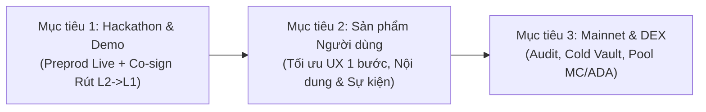

# Mục Tiêu & Lộ Trình Phát Triển — Vạn Cảnh Thiền Tự (Hydra Pagoda)

Tài liệu này xác định mục tiêu trọng tâm hiện tại (**Thi Hackathon / Gọi vốn / Demo kỹ thuật Cardano + Hydra**) đồng thời đặt nền móng rõ ràng cho cả 3 mục tiêu phát triển theo từng giai đoạn, giúp đội ngũ tập trung đúng nguồn lực và trả lời mạch lạc trước hội đồng giám khảo cũng như nhà đầu tư.

---

## 1. Tuyên ngôn giá trị cốt lõi (Elevator Pitch)

**Vạn Cảnh Thiền Tự (Hydra Pagoda)** là không gian chùa 3D WebGL kết hợp di sản văn hóa Á Đông, thực hành chánh niệm và hạ tầng **Cardano L1 + Hydra L2**. Dự án giải quyết bài toán thực tế lớn nhất của ứng dụng Web3 tiêu dùng: **làm sao giữ tài sản thật trên blockchain gốc nhưng mọi tương tác nhỏ hằng ngày vẫn nhanh ~60ms và hoàn toàn 0 phí gas.**

---

## 2. Ba mục tiêu chiến lược theo giai đoạn

| Mục tiêu | Trọng tâm | Đối tượng hướng tới | Trạng thái hiện tại |
|---|---|---|---|
| **Mục tiêu 1 (Ưu tiên ngay): Hackathon / Gọi vốn / Demo kỹ thuật Cardano + Hydra** | Chứng minh trọn vòng đời tài sản thực trên Cardano L1 kết hợp tốc độ ~60ms & 0 phí trên Hydra L2, không lỗ gas, không mất cọc `min-UTxO`. | Giám khảo Hackathon, Cardano Catalyst / Quỹ đầu tư, đối tác kỹ thuật. | Đã hoàn thiện ~90% (đã mint 1 tỷ MC Preprod, Hydra Head Open live, NFT CIP-68 thật, Wallet Gate, 57/57 test tự động PASS). |
| **Mục tiêu 2 (Trung hạn): Sản phẩm tiêu dùng mượt cho người chơi thật** | Trải nghiệm 3D nhẹ, mua 1 bước chơi ngay, nội dung bói quẻ / thiền 432Hz / cờ dân gian / AI Sư Thầy cuốn hút, giữ chân người dùng không cần hiểu blockchain. | Người dùng phổ thông yêu văn hóa, chánh niệm, giải trí nhẹ nhàng. | Đã có nền tảng 3D Đại Hùng Bảo Điện, Nhà Hầu Đồng, Bảo Tàng Di Sản Cổ Tự, 5 môn cờ, AI Sư Thầy. |
| **Mục tiêu 3 (Dài hạn): Hệ sinh thái Web3 thương mại & Thanh khoản tự do** | Cầu nối 2 chiều L1 ↔ L2 hoàn chỉnh, bộ sưu tập NFT CIP-68 giới hạn giao dịch trên chợ thứ cấp, thanh khoản cặp MC/ADA trên DEX Cardano (Minswap, SundaeSwap) và cơ chế đốt/tái chế token bền vững. | Cộng đồng Web3 Cardano, nhà sưu tầm NFT, người nắm giữ MC dài hạn. | Đã khóa cấu trúc tổng cung 1 tỷ MC & phân bổ 85/15 sẵn sàng cho Mainnet. |

---

## 3. Chi tiết Mục tiêu 1: Bộ tiêu chí chinh phục Hackathon & Gọi vốn

Để thuyết phục giám khảo kỹ thuật và nhà đầu tư trong phiên demo 5–10 phút, sản phẩm cần chứng minh trực tiếp **5 năng lực thực chiến** ngay trên mạng Cardano Preprod (không chạy giả lập):

1. **Quản trị danh tính & bảo mật chuẩn Web3 (Wallet Gate):** Người chưa kết nối ví vẫn được đi dạo tham quan không gian 3D, nhưng mọi số dư MC và toàn bộ API nghiệp vụ đều bị khóa chặt ở cả frontend lẫn backend bằng chữ ký CIP-8 (`401 wallet_required`), đổi ví tự xóa sạch trạng thái cũ.
2. **Tài sản thực minh bạch trên Cardano L1:** Token **MC** là Cardano Native Asset chuẩn (tổng cung cố định **1.000.000.000 MC**, `decimals = 0`), chính sách mint khóa vĩnh viễn theo slot (`TimelockExpiry`), kiểm chứng trực tiếp trên Cardanoscan Preprod.
3. **Sức mạnh Hydra Head L2 live:** Kết nối thực tới cụm Hydra Head (`Head Open`), mọi tương tác nhỏ trong chùa (dâng hương, công đức, rút quẻ, mua vật phẩm, thưởng thiền/cờ) đều tạo giao dịch L2 có UTxO + Inline Datum + Metadata CIP-20, xác nhận trong **~50–70ms** với **0 ADA phí gas** và hiển thị chứng thực ngay trên **Hydra Head Widget**.
4. **Sức mạnh riêng có của mô hình eUTxO Cardano (Co-sign):** Đúc **Thẻ Bài Di Sản Cổ Tự** chuẩn **CIP-68** (Reference Token 100 + Inline Datum + User Token 222) và cơ chế **Rút MC từ L2 về L1 bằng Co-sign** giúp người chơi nhận MC thật về ví Eternl mà không ai mất 1,2 ADA tiền cọc `min-UTxO` và Chùa tốn 0 ADA phí gas.
5. **Kỷ luật kỹ thuật & kiểm thử:** Toàn bộ tính giá 10 bậc dùng số nguyên tuyệt đối `BigInt`, chống replay `txHash`, chống race condition khi quỹ sắp cạn, đối soát bằng chứng dự trữ (Proof of Reserve) công khai.

---

## 4. Chi tiết Mục tiêu 2: Sản phẩm cho người dùng thật

Sau khi hoàn tất vòng demo/gọi vốn, trọng tâm chuyển sang **trải nghiệm mượt và giữ chân người dùng**:

- **Giảm ma sát tối đa:** Người dùng mới chỉ cần 1 bước (mua bằng ADA → có MC ngay trên L2 để dùng), không ép thực hiện nhiều bước chuyển cầu L1/L2 mới được chơi.
- **Giá trị giải trí & tâm linh thực chất:** Người chơi chi tiêu MC để lấy trải nghiệm thật (thư giãn thiền 432Hz, hỏi đáp AI Sư Thầy, bói quẻ 6 môn, chơi 5 môn cờ, trang trí vườn thiền, sưu tầm thẻ bài di sản song ngữ có âm thanh) thay vì mô hình "cày rút lãi" thiếu bền vững.
- **Hiệu năng WebGL:** Giữ khung hình mượt trên máy phổ thông, giao diện đồng nhất theo hệ thiết kế *Sơn mài và vàng thếp* (`DESIGN.md`).

---

## 5. Chi tiết Mục tiêu 3: Hệ sinh thái Web3 thương mại dài hạn

Chỉ triển khai lên Mainnet khi sản phẩm đã có lượng người dùng thực và hoàn tất kiểm toán bảo mật:

- **Chốt tổng cung Mainnet:** Mint một lần duy nhất 1 tỷ MC trên Mainnet theo tỷ lệ 85% Quỹ Bán / 15% Quỹ Nhiệm Vụ, lưu khóa lạnh (Cold Wallet / Multisig) cho phần lớn nguồn cung và chỉ nạp hạn mức nhỏ sang Ví Quỹ Nóng.
- **Thanh khoản thị trường tự do:** Đưa cặp **MC / ADA** lên sàn DEX Cardano để người nắm giữ MC tự do trao đổi theo cung cầu thị trường (Chùa không đứng ra mua lại trực tiếp bằng ngân khố để tránh rủi ro bị trục lợi từ thưởng nhiệm vụ).
- **Kinh tế NFT CIP-68:** Mở các bộ thẻ bài di sản theo mùa lễ hội (Phật Đản, Vu Lan, Tết) có độ hiếm rõ ràng và khả năng nâng cấp siêu dữ liệu động qua Reference Token chuẩn CIP-68.

---

## 6. Lộ trình thực hiện tóm tắt

- **Chặng 1 (Hiện tại — 1 tuần):** Hoàn tất kịch bản demo Hackathon, bỏ bắn đúp lúc mua, hoàn thiện nút **Rút MC (L2 → L1) bằng Co-sign**, chuẩn bị slide & video quay trực tiếp giao dịch Preprod + Cardanoscan + Hydra Head Widget.
- **Chặng 2 (1–2 tháng sau):** Thử nghiệm cộng đồng mở rộng (Open Beta), đo lường tỷ lệ giữ chân (retention), hoàn thiện sự kiện lễ hội và giải đấu cờ.
- **Chặng 3 (Khi đạt cộng đồng mục tiêu):** Kiểm toán khóa & hợp đồng, mint Mainnet, niêm yết DEX và mở rộng hệ sinh thái thẻ bài CIP-68.
