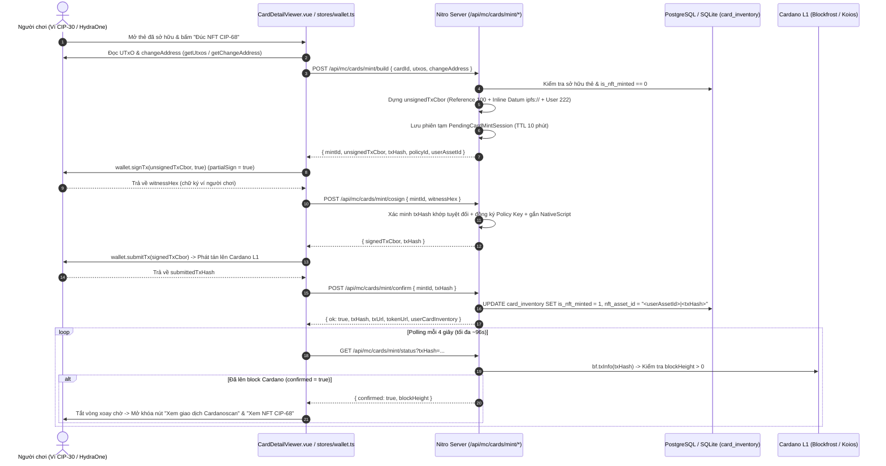

# Tài Liệu Kỹ Thuật: Đúc Thẻ Bài Di Sản Cổ Tự Thành NFT Chuẩn CIP-68 Trên Cardano

Tài liệu này mô tả chi tiết kiến trúc, chuẩn siêu dữ liệu on-chain **CIP-68 (Datum Metadata Standard)**, quy trình ký 2 bên (Co-sign), hệ thống lưu trữ ảnh vĩnh viễn trên **IPFS (Pinata)**, lược đồ API, cơ sở dữ liệu và hướng dẫn vận hành tính năng **Đúc NFT CIP-68 Thẻ Bài Di Sản Cổ Tự** trong dự án **Vạn Cảnh Thiền Tự (`hydra-pagoda`)**.

---

## 1. Tổng Quan & Giá Trị On-Chain

Trong **Vạn Cảnh Thiền Tự**, bộ sưu tập gồm **18 Thẻ Bài Di Sản Cổ Tự** (5 Việt Nam, 5 Nhật Bản, 4 Thái Lan, 4 Hàn Quốc) thuộc 4 phẩm cấp (`common`, `rare`, `epic`, `legendary`), được minh họa đồng bộ theo phong cách **Sơn mài và vàng thếp**.

- **Trong game (Off-chain / Hydra L2):** Người chơi sưu tầm thẻ bài qua Gacha Pack hoặc nhận quà cột mốc Sổ Tu Tập bằng Merit Coin (MC), có chứng thực tức thì trên Hydra Head L2.
- **Trên chuỗi Cardano L1 (On-chain CIP-68 NFT):** Với mỗi thẻ bài đã sở hữu (đã khai quang), người chơi có thể bấm **`Đúc NFT CIP-68`** ngay trên màn hình chi tiết thẻ (`CardDetailViewer.vue`) để chuyển hóa thẻ bài thành **tài sản số thực thụ nằm trong ví Cardano cá nhân** (Eternl, Lace, Vespr, Nami hoặc HydraOne Wallet Bridge), có thể xem trực tiếp ảnh nghệ thuật, tên và mô tả trên ví cũng như trên **Cardanoscan / Pool.pm / JPG Store**.

---

## 2. Kiến Trúc Chuẩn CIP-68 (`server/utils/cards/cip68Mint.ts`)

Khác với chuẩn cũ CIP-25 (chỉ lưu metadata tĩnh trong transaction metadata), dự án sử dụng chuẩn **Cardano CIP-68** hiện đại với cơ chế **cặp Token đồng bộ (`Reference Token` + `User Token`)** và **Plutus Inline Datum**:

### 2.1. Chính Sách Đúc (Minting Policy)
- **Loại Policy:** Native Script `ScriptPubkey` dẫn xuất tất định từ biến môi trường `NUXT_HYDRA_SESSION_SECRET` bằng `HMAC-SHA256(secret, "hydra-pagoda:cip68-heritage-policy:v1")`.
- **Tính nhất quán:** Chỉ cần giữ cố định `NUXT_HYDRA_SESSION_SECRET`, toàn bộ 18 thẻ bài trong bộ sưu tập sẽ luôn chung một **Policy ID** duy nhất trên Cardano (`nativeScript.hash()`), không thể bị bên ngoài giả mạo đúc trái phép vì khóa riêng Policy không bao giờ rời khỏi máy chủ.

### 2.2. Cấu Trúc Cặp Token Trong Một Giao Dịch Mint
Mỗi lần đúc một thẻ bài (ứng với bản ghi `serialNo = card_inventory.id`), giao dịch Cardano L1 tạo đồng thời **2 tài sản** từ cùng một `assetSlug` (ví dụ `vn_motcot_2`, tối đa 28 byte):

| Thành phần | Tiền tố Hex (4 byte) | Tên tài sản (Asset Name) | Nơi nhận & Vai trò |
| :--- | :--- | :--- | :--- |
| **Reference NFT (Label `100`)** | `000643b0` | `000643b0` + `hex(assetSlug)` | Gửi về địa chỉ lưu trữ `NUXT_TREASURY_ADDRESS` kèm **Plutus Inline Datum CIP-68**. Chứa toàn bộ siêu dữ liệu on-chain cho các ví và explorer tra cứu. |
| **User NFT (Label `222`)** | `000de140` | `000de140` + `hex(assetSlug)` | Gửi thẳng về **ví Cardano của người chơi (`account.address`)**. Người chơi toàn quyền sở hữu, trưng bày hoặc chuyển nhượng tự do. |

### 2.3. Cấu Trúc Plutus Inline Datum CIP-68
Reference Token `(100)` mang **Inline Datum** đúng đặc tả CIP-68:
```text
Constr 0 [
  Map<ByteString, PlutusData> {
    "name"       : "<Tên thẻ> #<serialNo>"          (<= 62 bytes UTF-8)
    "image"      : "ipfs://<CID>"                   (hoặc URL PNG fallback)
    "mediaType"  : "image/png"
    "description": "<Phụ đề / mô tả ngắn>"          (<= 62 bytes UTF-8)
    "collection" : "Van Canh Thien Tu - Di San Co Tu"
    "cardId"     : "<card.id>"
    "rarity"     : "common | rare | epic | legendary"
    "country"    : "VN | JP | TH | KR"
    "category"   : "architecture | wisdom"
  },
  Int 1,   // CIP-68 version = 1
  List []  // extra fields
]
```

> **Lưu ý tối ưu hiển thị trên ví Eternl:**
> - Các trường `name` và `description` được giới hạn gọn trong `<= 62 bytes` UTF-8 dạng `PlutusBytes` đơn (`truncateUtf8Bytes`) để ví Eternl hiển thị trực tiếp tiếng Việt có dấu rõ ràng, không bị rơi sang dạng mã hex `0x...`.
> - Min-UTxO của cả Reference Output và User Output được tính tự động theo kích thước byte thực tế của Inline Datum bằng `CardanoWASM.min_ada_for_output(output, DataCost.new_coins_per_byte(coinsPerUtxoSize)) + 100_000 lovelace`, đảm bảo không bao giờ gặp lỗi `less than the minimum UTXO value`.
> - Chọn đầu vào (Coin Selection) sử dụng chiến lược **`CoinSelectionStrategyCIP2.LargestFirstMultiAsset`** để hỗ trợ ví người chơi đang chứa nhiều token khác nhau.

---

## 3. Sơ Đồ Luồng Đúc NFT CIP-68 (Co-Sign 2 Bên)

Người chơi trả phí mạng L1 (~0.18–0.25 ADA) + min-UTxO từ chính ví của mình, còn máy chủ giữ độc quyền chữ ký Policy Key để chống đúc giả:



---

## 4. Lưu Trữ Ảnh Vĩnh Viễn Trên IPFS (`scripts/cards-upload-ipfs.mjs`)

Toàn bộ 18 ảnh nghệ thuật **Sơn mài & Vàng thếp** (`public/images/cards/<card_id>.png`) được pin vĩnh viễn lên **IPFS** và gắn trực tiếp vào trường `ipfsImage` trong `data/cards/catalog.json` (ví dụ `"ipfsImage": "ipfs://QmPqvWQ7szt7dZZcJPcZWGHngoj2WpyjwxUQrnFEgXZDng"`).

### Cách cập nhật hoặc tải lại ảnh lên IPFS
1. Cấu hình 1 trong 2 khóa trong file `.env`:
   ```dotenv
   # Cách 1: Pinata JWT (khuyên dùng)
   PINATA_JWT=<JWT_tu_pinata.cloud>

   # Cách 2: Blockfrost IPFS
   BLOCKFROST_IPFS_PROJECT_ID=<ipfs_project_id_tu_blockfrost.io>
   ```
2. Chạy lệnh tải ảnh lên IPFS:
   ```bash
   # Chỉ tải các thẻ chưa có ipfsImage
   npm run cards:upload-ipfs

   # Tải lại toàn bộ 18 thẻ (khi thay đổi ảnh mới)
   node scripts/cards-upload-ipfs.mjs --force
   ```
3. Script tự động pin file `.png` lên IPFS và cập nhật trường `"ipfsImage": "ipfs://<CID>"` vào `data/cards/catalog.json`. Khi đúc NFT, `cip68Mint.ts` tự động ưu tiên `card.ipfsImage` trước khi fallback về URL ảnh web.

---

## 5. Danh Mục API Endpoints & Cơ Sở Dữ Liệu

### 5.1. API Endpoints (`/api/mc/cards/mint/*`)

| Phương thức & Đường dẫn | Đầu vào | Đầu ra (200 OK) | Bảo vệ |
| :--- | :--- | :--- | :--- |
| `POST /api/mc/cards/mint/build` | `{ cardId, utxos, changeAddress? }` | `{ ok, mintId, cardId, serialNo, unsignedTxCbor, txHash, feeLovelace, policyId, refAssetId, userAssetId, network }` | `requireSession`, `assertSameOrigin`, Rate limit 12/phút |
| `POST /api/mc/cards/mint/cosign` | `{ mintId, witnessHex }` | `{ ok, mintId, signedTxCbor, txHash, policyId, refAssetId, userAssetId }` | `requireSession`, `assertSameOrigin`, kiểm tra khớp `accountId` & `txHash` |
| `POST /api/mc/cards/mint/confirm` | `{ mintId, txHash }` | `{ ok, cardId, txHash, policyId, refAssetId, userAssetId, txUrl, tokenUrl, userCardInventory }` | `requireSession`, `assertSameOrigin`, kiểm tra khớp `session.txHash` |
| `GET /api/mc/cards/mint/status` | `?txHash=<64 hex>` | `{ ok, confirmed: boolean, blockHeight: number \| null, blockTime?: number }` | `Cache-Control: no-store` |

### 5.2. Cơ Sở Dữ Liệu (`card_inventory` — Migration #9)
- Bảng `card_inventory` đã có sẵn 2 cột phục vụ NFT:
  - `is_nft_minted`: `0` (chưa đúc) hoặc `1` (đã đúc lên Cardano L1).
  - `nft_asset_id`: lưu chuỗi `<userAssetId>|<txHash>` để giao diện khôi phục nhanh cả link Token (`.../token/<userAssetId>`) lẫn link Giao dịch (`.../transaction/<txHash>`) trên Cardanoscan sau mỗi lần tải lại trang.
- API `GET /api/mc/cards/inventory` (qua `getUserCardInventory`) trả kèm `MAX(is_nft_minted)` và `MAX(nft_asset_id)` cho từng `card_id`.

---

## 6. Thành Phần Mã Nguồn Liên Quan

| Tệp | Vai trò |
| :--- | :--- |
| `server/utils/cards/cip68Mint.ts` | Dẫn xuất Policy Key, dựng Plutus Inline Datum CIP-68, tính min-UTxO tự động (`min_ada_for_output`), dựng `unsignedTxCbor` (`LargestFirstMultiAsset`) và đồng ký `cosignCip68MintTx`. |
| `server/utils/cards/mintSessionStore.ts` | Lưu tạm các phiên Mint đang chờ ký (TTL 10 phút) phía server để chống giả mạo giao dịch. |
| `server/utils/cards/catalog.ts` & `data/cards/catalog.json` | Danh mục 18 Thẻ Bài Di Sản kèm đường dẫn `ipfsImage` cho từng thẻ. |
| `server/api/mc/cards/mint/{build,cosign,confirm}.post.ts` & `status.get.ts` | 4 endpoint điều phối trọn vòng đời Mint CIP-68 và kiểm tra xác nhận block on-chain. |
| `stores/wallet.ts` (`mintHeritageCardNft`) | Luồng client gọi ví (hỗ trợ cả CIP-30 trực tiếp lẫn HydraOne Wallet Bridge trong iframe). |
| `stores/cards.ts` (`getCardMintInfo`, `applyInventory`) | Quản lý trạng thái đã đúc NFT của từng thẻ trên client. |
| `components/cards/CardDetailViewer.vue` | Giao diện chi tiết thẻ: nút `Đúc NFT CIP-68`, vòng xoay chờ xác nhận block (`Đang xác nhận lên block Cardano (~20-40s)...`), và link `Xem giao dịch Cardanoscan` / `Xem NFT CIP-68`. |
| `scripts/cards-upload-ipfs.mjs` | Công cụ CLI (`npm run cards:upload-ipfs`) tự động pin ảnh lên Pinata / Blockfrost IPFS và cập nhật `catalog.json`. |
