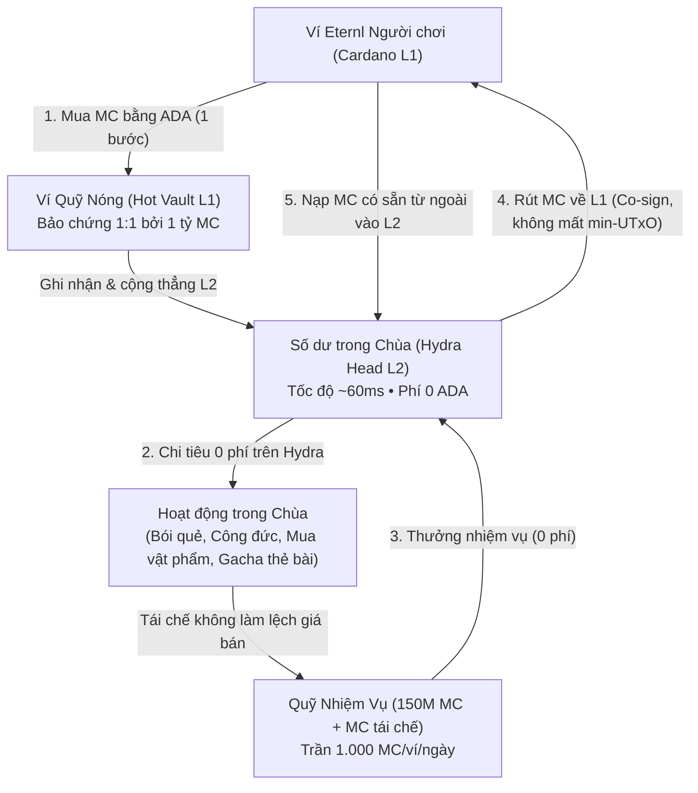

# Phương Án Kinh Tế & Vận Hành Token MC — Vạn Cảnh Thiền Tự

Tài liệu này trình bày phương án thiết kế kinh tế token **MC (Merit Coin)**, phân tích các mô hình thay thế và lý do lựa chọn mô hình **Hybrid (Mua 1 bước vào L2 + Cầu Rút/Nạp Co-sign L1 ↔ L2)** cho cả 3 mục tiêu: Demo Hackathon, Sản phẩm người dùng thật và Hệ sinh thái dài hạn.

---

## 1. Cấu trúc tổng cung & phân bổ cố định

Token **MC** là Cardano Native Asset (`decimals = 0`, tên hex `4d43`), tổng cung cố định **1.000.000.000 MC**, mint đúng một lần và khóa cứng policy bằng `TimelockExpiry`.

| Quỹ | Tỷ lệ | Số lượng MC | Mục đích sử dụng | Ảnh hưởng giá bán |
|---|---|---|---|---|
| **Quỹ Bán (Sale Pool)** | 85% | 850.000.000 MC | Phân phối cho người dùng mua bằng ADA theo 10 bậc giá tăng dần. | Trực tiếp quyết định bậc giá hiện tại. |
| **Quỹ Nhiệm Vụ (Quest Pool)** | 15% | 150.000.000 MC | Thưởng dâng hương, tọa thiền 432Hz, chơi cờ, leo núi, điểm danh. | **Không** ảnh hưởng bậc giá Quỹ Bán. |

---

## 2. Cơ chế định giá 10 bậc (Bonding Curve rời rạc)

Mỗi bậc gồm **85.000.000 MC**, giá tính bằng số nguyên **lovelace/MC** (`BigInt`), tăng xấp xỉ ×1,2 mỗi bậc:

| Bậc | Khoảng MC tích lũy | Giá (lovelace / MC) | 1 ADA mua được (làm tròn xuống) |
|---|---|---|---|
| 1 | 0 – 85M | 1.000 | 1.000 MC |
| 2 | 85M – 170M | 1.200 | 833 MC |
| 3 | 170M – 255M | 1.440 | 694 MC |
| 4 | 255M – 340M | 1.728 | 578 MC |
| 5 | 340M – 425M | 2.074 | 482 MC |
| 6 | 425M – 510M | 2.488 | 401 MC |
| 7 | 510M – 595M | 2.986 | 334 MC |
| 8 | 595M – 680M | 3.583 | 279 MC |
| 9 | 680M – 765M | 4.300 | 232 MC |
| 10 | 765M – 850M | 5.160 | 193 MC |

**Quy tắc bảo vệ hệ thống:**
- Giá luôn do backend tính từ tổng MC đã bán thực tế (`mc_fund_state.sale_sold`); frontend không bao giờ được tự gửi giá.
- Đơn mua vượt ranh giới bậc được chia từng phần theo đúng giá của từng bậc đã đi qua; số MC làm tròn xuống có lợi cho hệ thống, phần lovelace dư lẻ không thu.
- Mức mua tối thiểu **5 ADA/lần**; khi Quỹ Bán còn 0 thì khóa nút mua và hiển thị `"Hết MC"`.

---

## 3. So sánh 3 phương án dòng tiền & lý do chọn phương án Hybrid

| Tiêu chí | Phương án A: 2 bước thuần kỹ thuật (Mua L1 → Tự nạp L2) | Phương án B: Chỉ L2, không cho rút L1 | Phương án C (ĐƯỢC CHỌN): Hybrid — Mua 1 bước vào thẳng L2 + Cổng Rút/Nạp Co-sign |
|---|---|---|---|
| Số thao tác để bắt đầu chơi | 2 lần ký ví, chờ 2 block (~40–60s), 2 lần phí gas | 1 lần ký ví | **1 lần ký ví (~20s) là chơi ngay** |
| Trải nghiệm trong chùa | 0 phí, ~60ms trên Hydra L2 | 0 phí, ~60ms trên Hydra L2 | **0 phí, ~60ms trên Hydra L2** |
| Chứng minh sở hữu token thật | Có | Không (dễ bị nghi là điểm ảo) | **Có (rút về Eternl bất cứ lúc nào)** |
| Rủi ro nhân đôi tiền | Không | Không | **Không (1 MC chỉ ở L1 hoặc L2, bảo toàn 1:1)** |
| Phù hợp Hackathon & Sản phẩm thật | Kém UX | Thiếu điểm kỹ thuật L1 | **Đạt tối đa cả UX lẫn kỹ thuật** |

---

## 4. Vòng tuần hoàn MC (Token Flow & Token Sink)

### Giải bài toán động lực người chơi (Không rơi vào bẫy Ponzi)
- **Không hứa hẹn "chơi để rút lãi":** Dự án tránh hoàn toàn mô hình trả lãi từ tiền người sau.
- **Ba giá trị bền vững cho người chơi:**
  1. **Giá trị sử dụng (Utility):** Chi tiêu MC cho trải nghiệm 3D, bói quẻ 6 môn, thiền 432Hz, chơi 5 môn cờ, hỏi đáp AI Sư Thầy và dâng lễ.
  2. **Giá trị sưu tầm (CIP-68 NFT):** Mở gói và đúc **Thẻ Bài Di Sản Cổ Tự** thành NFT thật trên Cardano, sở hữu vĩnh viễn và có thể giao dịch trên chợ NFT.
  3. **Lợi thế người tham gia sớm:** Hệ thống 10 bậc giá tạo lợi thế tự nhiên cho người ủng hộ sớm; khi đủ cộng đồng ở Mục tiêu 3, cặp **MC / ADA** giao dịch tự do theo cung cầu trên sàn DEX Cardano.

---

## 5. Xử lý bài toán `min-UTxO` & Chống lạm dụng

- **Không ai mất 1,2 ADA tiền cọc `min-UTxO`:** Khi người chơi rút MC (`L2 → L1`), giao dịch sử dụng cơ chế **Co-sign 2 bên** (tương tự đúc NFT CIP-68). Người chơi tự dùng 1,2 ADA trong ví của mình để bọc gói MC trả về chính ví họ (không mất tiền cọc), chỉ trả đúng ~0,18 ADA phí mạng; Ví Quỹ Nóng tốn **0 ADA**.
- **Chống farm thưởng nhiệm vụ:**
  - Mọi thưởng nhiệm vụ đều đi qua cổng duy nhất `grantQuestReward`, gắn chặt với `wallet_address` đã ký CIP-8.
  - Áp dụng chống trùng theo chu kỳ (`UNIQUE(quest_key, wallet_address, period_key)`), cooldown chống spam và **trần tổng 1.000 MC/ví/ngày**.
  - Cảnh báo tự động khi Quỹ Nhiệm Vụ còn dưới 10%; khi cạn quỹ thì nhiệm vụ vẫn hoàn thành bình thường nhưng thông báo `"hết thưởng"`.
  - Khi lên Mainnet (Mục tiêu 3), bổ sung quy tắc kiểm soát rút đối với phần MC thưởng miễn phí để chống tạo nhiều ví clone.

---

## 6. Bằng chứng dự trữ (Proof of Reserve)

Tại mọi thời điểm, hệ thống đảm bảo bất biến kế toán công khai có thể đối soát trực tiếp giữa PostgreSQL/Hydra L2 và Cardanoscan:

- `Tổng MC trong Ví Quỹ Nóng (L1) + Ví Quỹ Lạnh (L1) >= Tổng số dư MC L2 của toàn bộ người chơi`
- `Tổng MC đã bán (sale_sold) <= 850.000.000 MC`
- `Tổng cung on-chain của Asset Unit MC === 1.000.000.000 MC` (policy đã khóa vĩnh viễn).
