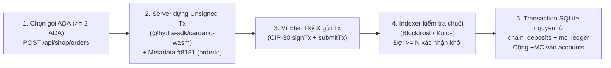
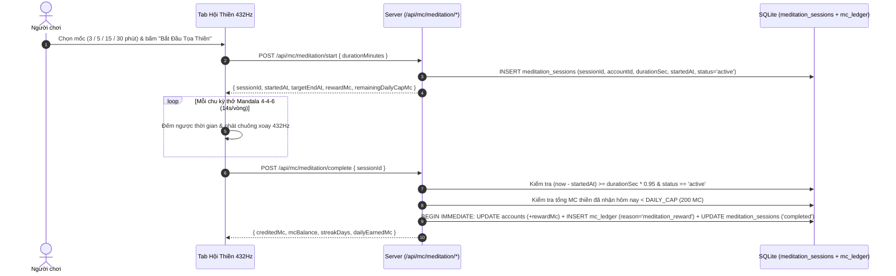
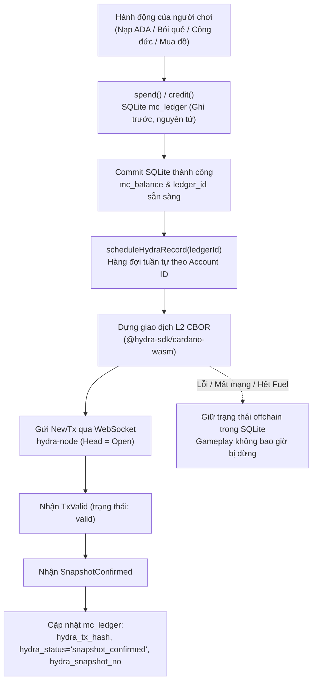

# Cơ chế MC Coin, Kế hoạch Tọa Thiền Nhận MC & Kiến Trúc Hybrid Cardano Hydra L2

Tài liệu này giải thích chi tiết:
1. **Bản chất của MC Coin & Cơ chế Mua / Tiêu MC hiện tại** trong dự án **Vạn Cảnh Thiền Tự (`hydra-pagoda`)**.
2. **Kế hoạch thiết kế tính năng "Tọa Thiền 432Hz Nhận Thưởng MC Coin"** (chống AFK/gian lận, giới hạn trần mỗi ngày).
3. **Cơ chế Dự phòng Kép: Đưa MC Coin lên Cardano Hydra L2 + SQLite Fallback (Đã Triển Khai)**: giá trị của Hydra L2, kiến trúc Hybrid thực tế đã code, mô hình khóa server HMAC-SHA256, State UTxO với Inline Datum, hàng đợi tuần tự, giao diện hiển thị và bộ kiểm thử 11/11 ca.

---

## Phần 1. Giải thích Bản chất MC Coin & Cơ chế Mua / Tiêu MC Hiện tại

### 1.1. MC Coin là gì?
- **MC Coin (Merit Coin / Điểm Tâm Duyên)** là **đơn vị điểm nội bộ trong game (Off-chain In-Game Currency)** được lưu trữ và bảo chứng bởi Sổ cái Máy chủ (`mc_ledger` trong SQLite WAL).
- **Tỷ lệ quy đổi chuẩn**:
  - `1 ADA = 1.000.000 lovelace = 1.000 MC`
  - `1 MC = 1.000 lovelace`
  - Toàn bộ hệ thống chỉ dùng **số nguyên (`INTEGER`)**, không dùng số thực để tránh sai số làm tròn.
- **Tính chất một chiều**:
  - Người chơi có thể dùng **ADA trên chuỗi Cardano L1** để mua **MC Coin** (hoặc nhận thưởng MC qua hoạt động tu tập như **Tọa Thiền**).
  - MC Coin chỉ dùng để tiêu dùng bên trong chùa (*Bói Quẻ 6 Môn, Cửa Hàng Cổ Phục & Lễ Phẩm, Khai Quang Thẻ Bài Di Sản 3D, Hòm Công Đức*), **không đổi ngược ra ADA**.

---

### 1.2. Cơ chế Mua MC Coin bằng ADA (On-chain L1 → Off-chain MC)



1. **Bước 1 — Khởi tạo đơn (`POST /api/shop/orders`)**:
   - Người chơi chọn gói (`5 / 10 / 50 / 100 ADA` hoặc nhập số nguyên `>= 2 ADA`).
   - Server tạo bản ghi `mc_orders` với `orderId` duy nhất, `expected_lovelace`, `expected_mc = expected_lovelace / 1000`, địa chỉ nhận `treasuryAddress` (lấy từ biến môi trường server) và thời hạn 30 phút.
2. **Bước 2 — Dựng giao dịch chuẩn xác bằng `@hydra-sdk/cardano-wasm` (`POST /api/shop/orders/:id/build`)**:
   - Trình duyệt đọc danh sách UTxO từ ví Eternl gửi lên server.
   - Server dùng `@hydra-sdk/cardano-wasm` dựng giao dịch trả đúng `expected_lovelace` tới `treasuryAddress`, đính kèm **Metadata nhãn `8181`** chứa `{ v: 1, app: "hydra-pagoda", orderId }` và lưu lại `unsigned_tx_hash`.
3. **Bước 3 — Ký & Phát tán qua Ví Eternl (`POST /witness` & `POST /submit`)**:
   - Ví Eternl bật popup yêu cầu người chơi nhập mật khẩu ký giao dịch (`signTx`).
   - Server kiểm tra `txHash` không bị tráo đổi, ghép `Vkeywitnesses` vào giao dịch và trả `signedTxCbor` để ví phát tán lên mạng Cardano (`submitTx`).
4. **Bước 4 — Theo dõi & Xác thực trên chuỗi (Blockfrost / Koios)**:
   - Tiến trình nền `order-watcher.ts` (mỗi 15 giây) và polling từ UI (mỗi 5 giây) truy vấn chuỗi Cardano để kiểm tra 4 điều kiện bắt buộc:
     1. Giao dịch đã nằm trong block và đạt `>= N` xác nhận (`1` trên Preprod, `3` trên Mainnet).
     2. Có đầu ra (UTxO output) chuyển về đúng `treasuryAddress`.
     3. Tổng `lovelace` chuyển về `treasuryAddress` `>= expected_lovelace`.
     4. Metadata nhãn `8181` (hoặc `674`) khớp đúng `orderId`.
5. **Bước 5 — Cộng MC nguyên tử & Chống cộng trùng (`Idempotency`)**:
   - Trong một transaction SQLite (`BEGIN IMMEDIATE`), server ghi `tx_hash` vào bảng `chain_deposits` (`tx_hash PRIMARY KEY`), cộng `creditedMc = Math.floor(receivedLovelace / 1000)` vào `accounts.mc_balance`, và ghi bút toán dương `+creditedMc` vào `mc_ledger`.

---

### 1.3. Cơ chế Tiêu MC Coin trong Chùa (Off-chain Atomic Spend)

Khi người chơi đã có MC trong tài khoản và thực hiện **Xem quẻ / Mua cổ phục / Thỉnh thẻ bài / Công đức**:
- Không cần bật popup ví Eternl ký giao dịch L1 (nhờ đó **không tốn ~0.18 ADA phí mạng** cho mỗi lần rút quẻ 10 MC và **phản hồi tức thì trong 0.1 giây**).
- Mọi hành động đều đi qua hàm trung tâm `spend(accountId, amount, reason, requestId)` trên server:
  - Kiểm tra phiên đăng nhập `httpOnly` hợp lệ.
  - Kiểm tra `UNIQUE(reason, ref_id)` trong `mc_ledger` để chống trừ tiền 2 lần khi mạng lag (`Idempotency`).
  - Trừ số dư có điều kiện nguyên tử `UPDATE accounts SET mc_balance = mc_balance - ? WHERE id = ? AND mc_balance >= ?` (chống số dư âm kể cả khi 10 luồng bắn cùng lúc).

---

## Phần 2. Kế hoạch Tính năng "Tọa Thiền 432Hz Nhận Thưởng MC Coin" (Chưa code)

Vì **MC Coin là điểm Tâm Duyên / Phước Đức trong chùa**, việc cho phép người chơi **nhận thưởng MC khi hoàn thành khóa Tọa Thiền 432Hz (`Hội Thiền`)** giúp:
- Người chơi mới chưa nạp ADA vẫn có thể thông qua tu tập (ngồi thiền điều tức Mandala 4-4-6) để tích lũy MC xem quẻ, dâng hương, công đức.
- Tăng gắn kết (retention) đúng tinh thần Chánh Niệm của **Vạn Cảnh Thiền Tự**.

### 2.1. Bảng Định mức Thưởng Tọa Thiền Đề xuất

| Thời lượng khóa thiền | Thưởng MC cơ bản | Điểm Định Tâm (Karma) | Điều kiện hoàn thành |
|---|---|---|---|
| **3 Phút** | **`+15 MC`** | `+5 Karma` | Giữ phiên thiền đủ 180 giây |
| **5 Phút** | **`+30 MC`** | `+10 Karma` | Giữ phiên thiền đủ 300 giây |
| **15 Phút** | **`+80 MC`** | `+30 Karma` | Giữ phiên thiền đủ 900 giây |
| **30 Phút** | **`+150 MC`** | `+60 Karma` | Giữ phiên thiền đủ 1.800 giây |

- **Giới hạn trần mỗi ngày (Daily Cap)**: Tối đa **`200 MC / ngày / tài khoản`** từ hoạt động ngồi thiền (ngăn việc treo máy cày MC vô hạn làm loãng kinh tế).
- **Thưởng Chuỗi Ngày Liên Tiếp (Streak Bonus)**: Tọa thiền liên tục `>= 3 ngày` được cộng thêm `+20% MC` (vẫn nằm trong trần `200 MC/ngày`).

### 2.2. Kiến trúc Chống Gian lận (Server-Verified Meditation Timer)

Tuyệt đối **không** để client tự gửi lệnh "cộng X MC" bất kỳ lúc nào. Luồng xác thực ở Server gồm 3 bước:



### 2.3. Các File sẽ thay đổi khi triển khai (Chờ duyệt mới code)
1. `server/db/migrations.ts`: Thêm bảng `meditation_sessions` (`session_id PRIMARY KEY`, `account_id`, `duration_sec`, `reward_mc`, `started_at`, `completed_at`, `status`).
2. `server/utils/wallet/mcService.ts`: Thêm hàm `startMeditationSession(accountId, durationMinutes)` và `completeMeditationSession(accountId, sessionId)` (cộng MC nguyên tử và ghi `mc_ledger` với `reason = 'meditation_reward'`).
3. `server/api/mc/meditation/start.post.ts` & `complete.post.ts`: 2 endpoint bắt đầu và nhận thưởng khóa thiền.
4. `components/SanctuaryDrawer.vue` (Tab `Hội Thiền 432Hz`): Hiển thị đồng hồ đếm ngược thật (`MM:SS`), mức thưởng `+MC` trên từng nút `3 / 5 / 15 / 30 Phút`, thanh tiến độ `MC nhận hôm nay (X / 200 MC)` và thông báo cộng MC khi hoàn tất khóa thiền.

---

## Phần 3. Cơ chế Dự phòng Kép: Đưa MC Coin lên Cardano Hydra L2 + SQLite Fallback (Đã Triển Khai)

### 3.1. Giá trị & Tác dụng khi đưa MC Coin lên Cardano Hydra L2

Việc đưa các giao dịch MC Coin lên kênh trạng thái **Hydra Head L2** giải quyết trọn vẹn bài toán dung hòa giữa trải nghiệm mượt mà của game và tính minh bạch của công nghệ chuỗi khối:

1. **Trải nghiệm mượt mà không độ trễ (0 Popup ví, 0 Phí gas, < 100ms)**: Mọi giao dịch L2 trong Head đều có phí bằng `0` và thời gian chốt snapshot tức thì, giúp người chơi không bị gián đoạn cảm xúc thiền định.
2. **Chứng thực mật mã học phi tập trung (Cryptographic Proof & Notary Mode)**: Mỗi lần cộng hoặc trừ MC đều sinh ra một giao dịch Cardano UTxO thật sự (`NewTx` → `TxValid` → `SnapshotConfirmed`) được đồng thuận và ký số bởi các bên tham gia Hydra Head. Ngay cả quản trị viên máy chủ cũng không thể tự ý sửa đổi số dư nếu không có chứng chỉ hợp lệ.
3. **Tạo lưu lượng giao dịch thực tế cho Cardano L2**: Mọi hành vi tâm linh (*gieo quẻ, công đức, mua vật phẩm, nhận thưởng tọa thiền*) đều đóng góp vào chỉ số TPS thực của hệ sinh thái Cardano.

---

### 3.2. Nguyên tắc Cốt lõi của Cơ chế Kép (Hybrid Architecture)

Hệ thống được thiết kế theo mô hình **Sổ cái Lai (Hybrid Notary Architecture)** đã được lập trình hoàn chỉnh trong mã nguồn (`server/utils/hydra/*`):

- **SQLite `mc_ledger` luôn là nguồn sự thật tối thượng (Single Source of Truth)**: Mọi biến động số dư MC bắt buộc phải được ghi nhận và commit thành công trong một SQLite transaction nguyên tử, tuần tự và idempotent (chống trùng lặp bằng `request_id`).
- **Hydra L2 đóng vai trò là bản sao công chứng (Mirror / Notary Attestation)**: Sau khi SQLite commit xong, hệ thống đưa bút toán vào hàng đợi xử lý nền (`scheduleHydraRecord(ledgerId)`) để ký và xác nhận giao dịch tương ứng trên Hydra Head.
- **Sự cố Hydra không bao giờ làm gián đoạn gameplay (Non-blocking Fallback)**: Nếu `hydra-node` mất kết nối, tắt, hết Fuel UTxO hoặc giao dịch L2 không hợp lệ, bút toán vẫn giữ nguyên an toàn trong SQLite với trạng thái `offchain`. Hệ thống chỉ ghi log cảnh báo và người chơi vẫn tiếp tục chiêm bái bình thường.
- **Mặc định an toàn**: Biến môi trường mặc định là `HYDRA_L2_ENABLED=false`, cho phép lập trình viên chạy `npm run dev` thông thường mà không cần bật cụm Hydra Node phức tạp.



Các điểm kết nối nghiệp vụ trong mã nguồn:
- `server/utils/wallet/mcService.ts` (`spend` / `credit`): Sau khi commit bút toán, kích hoạt `scheduleHydraRecord`.
- `server/utils/wallet/orders.ts`: Khi nạp ADA qua L1 thành công, lệnh cộng MC cũng được đẩy vào hàng đợi L2.
- `server/api/auth/verify.post.ts`: Sau khi xác thực chữ ký CIP-8 đăng nhập ví, gọi `ensureAccountSession` để cấp khóa L2 cho tài khoản.
- `server/api/mc/{fortune/draw,merit/donate,shop/buy}`: Chờ tối đa 1500ms qua `getHydraProof` để trả kèm bằng chứng giao dịch `hydra` cho client hiển thị ngay lập tức.

---

### 3.3. Cấu hình Hệ thống (Environment Variables)

Hệ thống hỗ trợ cấu hình linh hoạt qua biến môi trường (hoặc file `.env`):

| Biến môi trường | Giá trị mặc định | Giải thích chức năng |
|---|---|---|
| `HYDRA_L2_ENABLED` | `false` | Bật `true` để kích hoạt luồng chứng thực sổ cái lên Hydra Head |
| `HYDRA_NODE_WS_URL` | `ws://127.0.0.1:4001` | Địa chỉ kết nối WebSocket của tiến trình `hydra-node` |
| `NUXT_HYDRA_SESSION_SECRET` | *(Tự sinh ngẫu nhiên)* | Khóa bí mật gốc để sinh các cặp khóa L2. Nếu để trống, server tự sinh và lưu vào bảng `hydra_kv` |
| `NUXT_HYDRA_STATE_LOVELACE` | `2000000` | Lượng lovelace tối thiểu (2 ADA) neo giữ trong mỗi State UTxO |
| `NUXT_HYDRA_FUEL_TARGET` | `10` | Số lượng UTxO nhiên liệu mong muốn duy trì trong Fuel Pool |
| `NUXT_HYDRA_SUBMIT_TIMEOUT_MS` | `8000` | Thời gian tối đa (8 giây) chờ phản hồi `TxValid` từ hydra-node |

---

### 3.4. Mô hình Quản lý Khóa: Server-Side HMAC-SHA256 (0 Popup Ví)

Để bảo đảm trải nghiệm không bị bật popup ví Eternl liên tục mỗi lần tiêu 10 MC, toàn bộ khóa L2 được dẫn xuất nội bộ trên máy chủ bằng thuật toán `HMAC-SHA256(serverSecret, label)`:

| Loại khóa | Nhãn dẫn xuất (Label) | Trách nhiệm trong hệ thống |
|---|---|---|
| **Fuel Key** | `hydra-pagoda:l2-fuel:v1` | Khóa chung nắm giữ UTxO nhiên liệu để trả phí đầu vào cho giao dịch L2 |
| **Session Key** | `hydra-pagoda:l2-session:v1:{accountId}:{l1Address}` | Khóa đại diện cho từng tài khoản, đứng tên sở hữu State UTxO của tài khoản đó |

- **An toàn bảo mật**: Máy chủ chỉ lưu khóa công khai `accounts.l2_session_vkey` và địa chỉ `accounts.l2_address`. Khóa riêng tuyệt đối không lưu vào database và không gửi xuống trình duyệt.
- **Địa chỉ Enterprise**: Địa chỉ L2 được tạo dưới dạng Cardano Enterprise Address, tự động áp dụng đúng Network ID (`preprod` hoặc `mainnet`).

---

### 3.5. Cấu trúc Giao dịch L2 & Giải pháp Chống Xung đột UTxO

Để tránh hiện tượng xung đột tài nguyên (`BadInputsUTxO`) khi nhiều người chơi cùng thực hiện giao dịch trong cùng một giây, hệ thống áp dụng 2 cơ chế:

1. **Bể Nhiên Liệu (Fuel Pool)**:
   - Các UTxO của Fuel Key được commit vào Head với mục tiêu duy trì ít nhất 10 UTxO (`NUXT_HYDRA_FUEL_TARGET`).
   - Hàm `buildFuelSplitTx` sẽ tự động chia nhỏ UTxO lớn thành các phần nhỏ khi số lượng UTxO trong pool giảm xuống.
   - Mỗi giao dịch của một tài khoản chỉ tiêu thụ đúng 1 Fuel UTxO độc lập, cho phép nhiều người chơi ghi giao dịch L2 song song.

2. **State UTxO Duy Nhất Kèm Inline Datum**:
   - Mỗi tài khoản người chơi chỉ sở hữu đúng **1 State UTxO** duy nhất tại `l2_address` của họ, mang theo Plutus Inline Datum định dạng:
     ```
     Constr 0 [ balance_after, ledger_id, delta_mc, account_id ]
     ```
     *Ví dụ:* Datum `[1100, 4, -800, 1]` thể hiện: Sau bút toán `#4` (trừ 800 MC), số dư hiện tại của tài khoản ID `1` là 1.100 MC.

3. **Metadata Chuẩn CIP-20 (Label 674)**:
   Mỗi giao dịch L2 gắn kèm metadata ghi chú minh bạch (mỗi dòng tối đa 64 bytes):
   - `Van Canh Thien Tu - Hydra L2 MC Ledger`
   - `Action: {reason} (±N MC)`
   - `Account: {l1Address}`
   - `Receipt: mc_{reason}_{refId}`

---

### 3.6. Hàng Đợi Tuần Tự & Vòng Đời 4 Trạng Thái

Module `server/utils/hydra/hydraQueue.ts` quản lý hàng đợi ghi nhận:

- **Tuần tự hóa theo từng tài khoản**: Sử dụng chuỗi Promise riêng biệt cho mỗi `accountId` nhằm bảo đảm State UTxO của một tài khoản luôn được tiêu thụ theo đúng thứ tự logic số dư, trong khi các tài khoản khác nhau vẫn chạy song song.
- **Bảo toàn dữ liệu trước khi gửi mạng**: Bản ghi `hydra_tx_hash` và trạng thái `submitted` được ghi vào SQLite **trước khi** phát lệnh `NewTx`, giúp không bị thất lạc giao dịch nếu tiến trình server bị khởi động lại.
- **Tự động thử lại (Retry)**: Khi gặp sự cố `hydra_tx_invalid`, hệ thống tự động làm mới bộ nhớ đệm UTxO và thực hiện thử lại 1 lần.

| Trạng thái `hydra_status` | Ý nghĩa kỹ thuật |
|---|---|
| `offchain` | Bút toán chỉ lưu trong SQLite (khi Hydra tắt, gặp lỗi kết nối hoặc chưa kịp đồng bộ) |
| `submitted` | Đã gửi lệnh `NewTx` vào WebSocket của hydra-node và đang chờ phản hồi |
| `valid` | Tiến trình hydra-node đã xác thực giao dịch hợp lệ thông qua sự kiện `TxValid` |
| `snapshot_confirmed` | Giao dịch đã được đưa vào snapshot và ký xác thực bởi các thành viên trong Head |

---

### 3.7. Endpoint Kiểm tra Trạng Thái Hệ thống (`GET /api/hydra/status`)

Cung cấp thông tin giám sát thời gian thực cho giao diện người dùng:
- `enabled`: Trạng thái bật/tắt Hydra L2 trong cấu hình.
- `connected`: Trạng thái kết nối WebSocket tới hydra-node.
- `mode`: Chế độ hoạt động hiện tại (`hydra_l2` khi Head đang Open, hoặc `local_ledger` khi chạy dự phòng).
- `headStatus`: Trạng thái kênh (`Open`, `Disconnected`, v.v.).
- `latestSnapshotNo`: Số thứ tự snapshot mới nhất đã được xác nhận.
- `totalL2Txs` / `confirmedL2Txs`: Tổng số giao dịch L2 đã gửi và số giao dịch đã chốt snapshot.
- `avgConfirmMs`: Thời gian phản hồi xác nhận trung bình.
- `fuelAddress`: Địa chỉ ví nhiên liệu đang vận hành.

---

### 3.8. Hiển thị Trực Quan trên Giao Diện Người Dùng

1. **Chỉ báo Chế độ Sổ cái trên HUD (`data-testid="hud-ledger-mode"`)**:
   - Hiển thị nhãn xanh `Hydra L2` khi kết nối thông suốt.
   - Hiển thị nhãn trung tính `SQLite` khi chạy ở chế độ dự phòng cục bộ.
2. **Huy hiệu Chứng thực Giao dịch [`HydraBadge.vue`](file:///d:/Vtechcom/hydra-pagoda/components/HydraBadge.vue)**:
   - Hiển thị minh bạch trạng thái của từng hành động:
     - `Hydra L2 · Snapshot #N · Tx abcd…wxyz` (khi đã `snapshot_confirmed`).
     - `Hydra L2 · Đã xác thực` (khi trạng thái là `valid`).
     - `Hydra L2 · Đang xác nhận` (khi trạng thái là `submitted`).
     - `SQLite · Ghi ở sổ cái cục bộ` (khi trạng thái là `offchain`).
   - Tích hợp tại: Kết quả bói quẻ, biên lai cúng dường, mua vật phẩm cửa hàng và từng dòng lịch sử quẻ đã gieo.

---

### 3.9. Vận Hành & Bộ Kiểm Thử Tự Động 11/11 Ca

Hệ thống được trang bị bộ kịch bản kiểm thử toàn diện tại `scripts/wallet/test-hydra-l2.mjs`:

```bash
# 1. Chạy hydra-node giả lập (phục vụ test nhanh)
npm run hydra:mock

# 2. Chạy bộ kiểm thử 11 ca tích hợp Hydra L2
npm run wallet:test:hydra
```

**11 ca kiểm thử bắt buộc luôn đạt 100% PASS**:
1. `GET /api/hydra/status`: Kiểm tra kết nối và trạng thái Head = Open.
2. Đăng nhập CIP-8 sinh khóa phiên Ephemeral (`l2_session_vkey`, `l2_address`).
3. Nạp 2 ADA (+2.000 MC) được ghi lên Hydra Head với `snapshot_confirmed`.
4. Gieo quẻ -50 MC nhận bằng chứng Hydra L2 (có `snapshotNo` và `txHash`).
5. Cúng dường -50 MC nhận bằng chứng Hydra L2.
6. Tính bất biến (Idempotent): Gửi lặp request không tạo thêm giao dịch L2 trùng.
7. Đúng 1 State UTxO trên Head mang inline datum khớp chính xác với SQLite.
8. Thống kê `/api/hydra/status` phản ánh đầy đủ các giao dịch đã xác nhận.
9. Mọi dòng bút toán trong `mc_ledger` đều lưu trữ đúng `hydra_tx_hash`.
10. Cơ chế Fallback: Khi ngắt kết nối hydra-node, giao dịch vẫn thành công và lưu `offchain`, không làm hỏng gameplay.
11. Đối soát bảo toàn: Tổng `SUM(delta_mc)` luôn bằng `accounts.mc_balance` (SQLite là nguồn sự thật).
