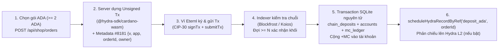
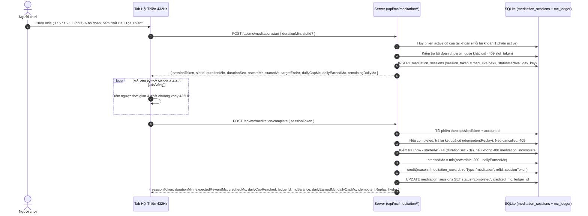
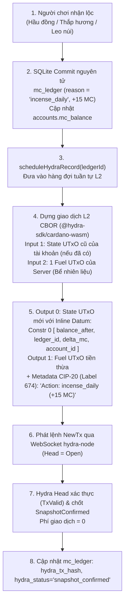
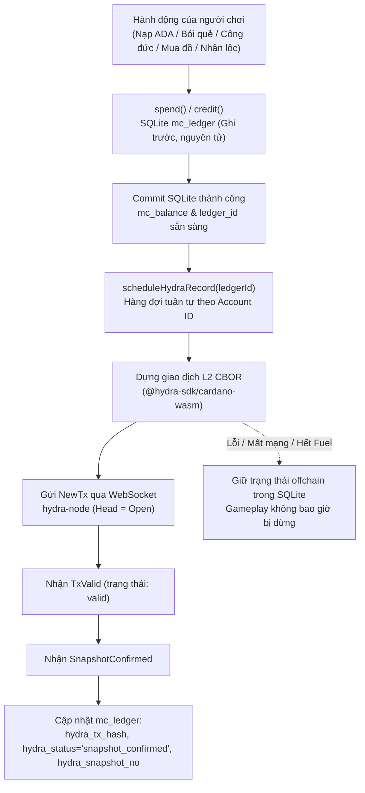
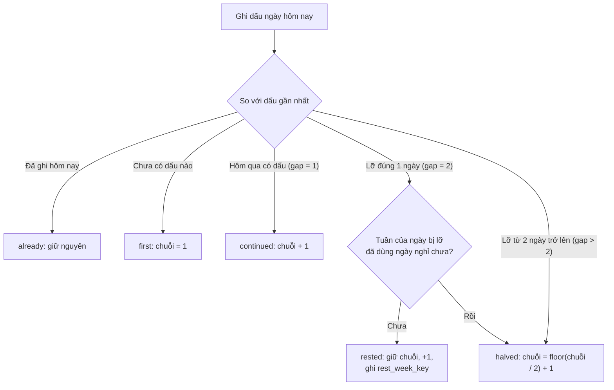

# Cơ chế MC Coin, Kế hoạch Tọa Thiền Nhận MC & Kiến Trúc Hybrid Cardano Hydra L2

Tài liệu này giải thích chi tiết:
1. **Bản chất của MC Coin & Cơ chế Mua / Tiêu MC hiện tại** trong dự án **Vạn Cảnh Thiền Tự (`hydra-pagoda`)**.
2. **Tính năng "Tọa Thiền 432Hz Nhận Thưởng MC Coin" (Đã Triển Khai)** (chống AFK/gian lận, giới hạn trần mỗi ngày) và **Cơ chế Nhận Lộc MC (Hầu đồng, Thắp hương, Leo núi) trên Cardano Hydra L2**.
3. **Cơ chế Dự phòng Kép: Đưa MC Coin lên Cardano Hydra L2 + SQLite Fallback (Đã Triển Khai)**: giá trị của Hydra L2, kiến trúc Hybrid thực tế đã code, mô hình khóa server HMAC-SHA256, State UTxO với Inline Datum, hàng đợi tuần tự, giao diện hiển thị và bộ kiểm thử 11/11 ca.
4. **Lớp Giữ Chân Không Dùng MC: Sổ Tu Tập & Ba Việc Lành (Đã Triển Khai)**: chuỗi ngày an lạc, cột mốc, ba việc lành mỗi ngày, quà là vật phẩm (không cộng MC, không qua Hydra L2), các bảng, endpoint và giới hạn đã biết.

5. **Hey Sumale, hiện tại game chưa dùng hợp đồng thông minh (Smart Contract / Plutus / Aiken script) nào cả.**

Cơ chế blockchain hiện nay của game đang chạy theo mô hình Sổ cái DB + Giao dịch thường (Key-based) trên Cardano L1 & Hydra L2:

Xác thực ví (CIP-30 / CIP-8): Người chơi ký thông điệp bằng ví Cardano để chứng minh quyền sở hữu địa chỉ ví (chỉ kiểm tra chữ ký mật mã, không qua smart contract).
Nạp ADA trên L1: Người chơi chuyển ADA trực tiếp tới địa chỉ ví kho bạc (NUXT_TREASURY_ADDRESS) như giao dịch chuyển tiền bình thường, không khóa tiền vào script/contract; backend kiểm tra giao dịch qua Blockfrost/Koios rồi cộng MC vào DB.
Hydra L2 (Notary Mode — l2TxBuilder.ts):
Dùng các địa chỉ khóa công khai thông thường (EnterpriseAddress từ keyhash, không phải địa chỉ script).
Có đính kèm inline Plutus datum (Constr 0 [balanceAfter, ledgerId, deltaMc, accountId]) và metadata CIP-20 (nhãn 674) vào UTxO trong Hydra Head để ghi nhận / công chứng biến động số dư (phí 0), nhưng không có validator/smart contract on-chain nào đứng ra khóa hay kiểm duyệt logic giao dịch.

Nói ngắn gọn: DB (PostgreSQL / SQLite) vẫn là nguồn sự thật chính, còn Cardano L1 dùng để nạp ADA và Hydra L2 đóng vai trò sổ công chứng tức thì (không dùng smart contract). Nếu sau này muốn mint NFT Thẻ Di Sản (CIP-68) hoặc khóa quỹ công đức minh bạch on-chain thì mới cần viết thêm smart contract (ví dụ bằng Aiken).

> Nội dung tài liệu được đối chiếu lại với mã nguồn hiện tại (`server/utils/wallet/*`, `server/utils/hydra/*`, `server/api/*`, `stores/*`, `components/*`). Các tính năng chưa có trong code được ghi rõ là "Dự kiến".

---

## Phần 1. Giải thích Bản chất MC Coin & Cơ chế Mua / Tiêu MC Hiện tại

### 1.1. MC Coin là gì?
- **MC Coin (Merit Coin / Điểm Tâm Duyên)** là **đơn vị điểm nội bộ trong game (Off-chain In-Game Currency)** được lưu trữ và bảo chứng bởi Sổ cái Máy chủ (`mc_ledger` trong SQLite WAL). Số dư hiện tại nằm ở `accounts.mc_balance`.
- **Tỷ lệ quy đổi chuẩn**:
  - `1 ADA = 1.000.000 lovelace = 1.000 MC`
  - `1 MC = 1.000 lovelace`
  - Toàn bộ hệ thống chỉ dùng **số nguyên (`INTEGER`)**, không dùng số thực để tránh sai số làm tròn.
- **Tính chất một chiều**:
  - Người chơi có thể dùng **ADA trên chuỗi Cardano L1** để mua **MC Coin** (hoặc nhận thưởng MC qua hoạt động tu tập như **Tọa Thiền**, **Hầu Đồng**, **Thắp Hương**, **Leo núi Parkour**).
  - MC Coin chỉ dùng để tiêu dùng bên trong chùa (*Bói Quẻ 6 Môn, Cửa Hàng Cổ Phục & Lễ Phẩm, Khai Quang Thẻ Bài Di Sản 3D, Hòm Công Đức, Bảo trợ Hầu Đồng, phí Parkour*), **không đổi ngược ra ADA**.

---

### 1.2. Cơ chế Mua MC Coin bằng ADA (On-chain L1 → Off-chain MC)



1. **Bước 1 — Khởi tạo đơn (`POST /api/shop/orders`)**:
   - Người chơi chọn gói nhanh (`QUICK_ADA_PACKAGES`) hoặc nhập số nguyên ADA từ `MIN_ORDER_ADA` (2 ADA) đến `MAX_ORDER_ADA`. Server cũng chấp nhận tham số `lovelace` (bội số của 1.000.000).
   - Server tạo bản ghi `mc_orders` với `orderId` dạng `ord_<base36 timestamp>_<12 hex>`, `expected_lovelace`, `expected_mc = floor(expected_lovelace / 1000)`, địa chỉ nhận `treasuryAddress` (lấy từ biến môi trường server, được kiểm tra đúng bech32 và đúng mạng) và thời hạn mặc định **30 phút** (`NUXT_ORDER_TTL_MINUTES`, tối thiểu 5 phút). Đơn `pending` / `signing` quá hạn sẽ được chuyển sang `expired`.
2. **Bước 2 — Dựng giao dịch chuẩn xác bằng `@hydra-sdk/cardano-wasm` (`POST /api/shop/orders/:id/build`)**:
   - Trình duyệt đọc danh sách UTxO từ ví gửi lên server (kèm `changeAddress`, mặc định là địa chỉ tài khoản).
   - Server dựng giao dịch trả đúng `expected_lovelace` tới `treasuryAddress`, đính kèm **Metadata nhãn `8181`** (`NUXT_ORDER_METADATA_LABEL`) chứa `{ v: 1, app: "hydra-pagoda", orderId, owner: [...] }` và thêm metadata **CIP-20 nhãn `674`** để ví hiển thị. Lưu `unsigned_tx_hash` / `unsigned_tx_cbor`, đơn chuyển sang `signing`.
3. **Bước 3 — Ký & Phát tán qua Ví (`POST /witness` & `POST /submit`)**:
   - Ví bật popup yêu cầu người chơi ký giao dịch (`signTx`).
   - Server (`/witness`) ghép `Vkeywitnesses` vào giao dịch và trả `signedTxCbor` để ví phát tán lên mạng Cardano (`submitTx`).
   - `/submit` nhận `txHash` từ client, kiểm tra khớp với `unsigned_tx_hash` (nếu lệch trả `tx_hash_mismatch`), chống dùng lại hash của đơn khác (`tx_hash_already_used`) và chỉ chuyển đơn sang `submitted`, **chưa cộng MC**.
4. **Bước 4 — Theo dõi & Xác thực trên chuỗi (Blockfrost / Koios)**:
   - Tiến trình nền `server/plugins/order-watcher.ts`: quét **mỗi 15 giây** khi có đơn đang chờ; khi rảnh sẽ giãn nhịp còn khoảng **90 giây** để tiết kiệm rate limit. Hàm `syncPendingOrdersFromChain` có chặn tần suất tối thiểu 8 giây/lần. Đồng thời store `stores/wallet.ts` polling đơn **mỗi 5 giây** từ UI.
   - Mỗi lượt quét kiểm tra các đơn `signing / submitted / confirming` và 30 giao dịch gần nhất tới `treasuryAddress` (bắt cả trường hợp người chơi đóng tab sau khi gửi giao dịch).
   - Điều kiện để quyết toán đơn trong `inspectAndSettleTx`:
     1. Giao dịch đã nằm trong block và đạt `>= N` xác nhận (`NUXT_CONFIRMATIONS_REQUIRED`, mặc định `1` trên Preprod, `3` trên Mainnet). Chưa đủ thì đơn ở trạng thái `confirming`; nếu giao dịch biến mất do rollback thì đơn quay về `submitted`.
     2. Metadata nhãn `8181` (hoặc dòng CIP-20 nhãn `674` chứa `ord_...`) khớp đúng `orderId`.
     3. Có đầu ra chuyển về đúng `treasuryAddress`; giao dịch do chính treasury chi ra bị bỏ qua (`ignored_self_spend`).
     4. Tổng `lovelace` chuyển về `treasuryAddress` `>= expected_lovelace`.
5. **Bước 5 — Cộng MC nguyên tử & Chống cộng trùng (`Idempotency`)**:
   - Trong một transaction SQLite (`withTransaction`), server ghi `tx_hash` vào bảng `chain_deposits` (`tx_hash PRIMARY KEY`, `ON CONFLICT DO NOTHING`), cộng `creditedMc = Math.floor(receivedLovelace / 1000)` vào `accounts.mc_balance` (nếu trả thừa thì cộng theo số lovelace thực nhận), ghi bút toán dương `+creditedMc` (reason `deposit_ada`, ref là `orderId`) vào `mc_ledger` và cập nhật đơn sang `completed`.
   - Sau khi commit, hệ thống gọi `scheduleHydraRecordByRef('deposit_ada', orderId)` để đẩy bút toán lên hàng đợi Hydra L2 (không chặn).
6. **Các trường hợp đặc biệt (không cộng MC, ghi nhận để đối soát)**:

| Trạng thái / hành động | Điều kiện | Kết quả |
|---|---|---|
| `underpaid` | Số lovelace nhận được nhỏ hơn `expected_lovelace` | Ghi `chain_deposits` với `mc_credited = 0`, đơn chuyển `underpaid`, chờ đối soát thủ công |
| `expired_paid` | Đơn đã hết hạn trước khi thanh toán nhưng vẫn có tiền về | Ghi `chain_deposits` với `mc_credited = 0`, chờ đối soát thủ công |
| `unmatched` | Có tiền vào treasury nhưng không có `orderId` hợp lệ (và đã đủ xác nhận) | Ghi `chain_deposits` với `order_id = NULL`, `status = 'unmatched'` |
| `metadata_mismatch` | Metadata không khớp đơn đang theo dõi | Không cộng MC, ghi cảnh báo `[wallet:metadata_mismatch]` |
| `already_processed` | `tx_hash` đã có trong `chain_deposits` hoặc đơn đã `completed` | Không cộng thêm, trả lại kết quả cũ |

---

### 1.3. Cơ chế Tiêu MC Coin trong Chùa (Off-chain Atomic Spend)

Khi người chơi đã có MC trong tài khoản và thực hiện **Xem quẻ / Mua cổ phục / Thỉnh thẻ bài / Công đức / Bảo trợ Hầu Đồng / Phí Parkour**:
- Không cần bật popup ví ký giao dịch L1 (nhờ đó **không tốn ~0.2 ADA phí mạng** cho mỗi lần rút quẻ và **phản hồi tức thì**).
- Mọi hành động đều đi qua hàm trung tâm `spend(accountId, amount, reason, refId, opts?)` trên server (`server/utils/wallet/mcService.ts`), chạy trong `withTransaction`:
  - Kiểm tra phiên đăng nhập `httpOnly` hợp lệ (ở lớp API).
  - Kiểm tra `UNIQUE(reason, ref_id)` trong `mc_ledger` để chống trừ tiền 2 lần khi mạng lag (`Idempotency`); gọi lặp sẽ chạy nhánh `onReplay` và không sinh bút toán mới.
  - Trừ số dư có điều kiện nguyên tử `UPDATE accounts SET mc_balance = mc_balance - ? WHERE id = ? AND mc_balance >= ?` (chống số dư âm kể cả khi nhiều luồng bắn cùng lúc).
  - `opts` gồm `refType`, `metadata`, `onSpent` (chạy cùng transaction để ghi dữ liệu nghiệp vụ như lịch sử quẻ, tồn kho) và `onReplay`.
  - Sau khi commit, gọi `void scheduleHydraRecord(ledgerId)` để phản chiếu lên Hydra L2.
- Chiều cộng MC dùng `credit(accountId, amount, reason, { refType?, refId, metadata? })` với cùng cấu trúc transaction, idempotent theo `UNIQUE(reason, ref_id)`.

---

## Phần 2. Tính năng "Tọa Thiền 432Hz Nhận Thưởng MC Coin" (Đã Triển Khai) & Cơ Chế Nhận Lộc MC Trên Hydra L2

Vì **MC Coin là điểm Tâm Duyên / Phước Đức trong chùa**, việc cho phép người chơi **nhận thưởng MC khi hoàn thành khóa Tọa Thiền 432Hz (`Hội Thiền`)** giúp:
- Người chơi mới chưa nạp ADA vẫn có thể thông qua tu tập (ngồi thiền điều tức Mandala 4-4-6) để tích lũy MC xem quẻ, dâng hương, công đức.
- Tăng gắn kết (retention) đúng tinh thần Chánh Niệm của **Vạn Cảnh Thiền Tự**.

### 2.1. Bảng Định mức Thưởng Tọa Thiền Đã Hoàn Thiện

Cấu hình trong `MEDITATION_PLANS` (`server/utils/wallet/mcService.ts`):

| Thời lượng khóa thiền | Thời gian giữ phiên | Thưởng MC |
|---|---|---|
| **3 Phút** | 180 giây | **`+15 MC`** |
| **5 Phút** | 300 giây | **`+30 MC`** |
| **15 Phút** | 900 giây | **`+80 MC`** |
| **30 Phút** | 1.800 giây | **`+150 MC`** |

- **Giới hạn trần mỗi ngày (Daily Cap)**: Tối đa **`200 MC / ngày / tài khoản`** (`DAILY_MEDITATION_CAP_MC`) từ hoạt động ngồi thiền. Ngày được tính theo **giờ Việt Nam (UTC+7)**. Khi gần chạm trần, phần thưởng được cắt còn `min(thưởng mốc, 200 - đã nhận hôm nay)` và phản hồi `dailyCapReached = true`.
- **Chưa triển khai (Dự kiến)**: điểm Định Tâm (Karma) và thưởng chuỗi ngày liên tiếp (Streak Bonus) **không có trong mã nguồn hiện tại**; phần thưởng chỉ là số MC cố định theo mốc ở bảng trên.

### 2.2. Kiến trúc Chống Gian lận (Server-Verified Meditation Timer)

Tuyệt đối **không** để client tự gửi lệnh "cộng X MC" bất kỳ lúc nào. Luồng xác thực ở Server:



Điểm kỹ thuật cần lưu ý:
- **Dung sai thời gian**: phiên chỉ hợp lệ khi đã trôi qua ít nhất `durationSec - 3` giây (`MEDITATION_EARLY_TOLERANCE_SEC = 3`), không dùng ngưỡng phần trăm.
- **Mỗi tài khoản chỉ có 1 phiên `active`**: bắt đầu phiên mới sẽ hủy phiên cũ. Bồ đoàn đang được giữ bởi phiên khác (còn hạn, có thêm `MEDITATION_SLOT_GRACE_MS = 60s` ân hạn) sẽ trả lỗi `409 slot_taken`.
- **`credit()` và cập nhật phiên là hai bước riêng**: `credit()` có transaction riêng, sau đó mới `UPDATE` phiên sang `completed`. Nếu server sập giữa chừng, lần `complete` kế tiếp sẽ tìm lại bút toán `meditation_reward` có `ref_id = sessionToken` để tái sử dụng, không cộng trùng (cùng với `UNIQUE(reason, ref_id)`).
- **Hủy phiên**: `POST /api/mc/meditation/cancel { sessionToken }` chỉ đổi trạng thái sang `cancelled`, không cộng MC.
- **Trạng thái**: `GET /api/mc/meditation/status` trả `plans`, `dailyCapMc`, `dailyEarnedMc`, `remainingDailyMc`, `occupiedSlotIds`, `totalSlots`.

### 2.3. Các File & Endpoint Đã Triển Khai Hoàn Tất Trong Hệ Thống
1. `server/db/migrations.ts` (migration v5 `meditation_sessions`): bảng `meditation_sessions` gồm `id`, `session_token` (`UNIQUE`), `account_id`, `slot_id`, `duration_min`, `duration_sec`, `expected_reward_mc`, `credited_mc`, `status` (`active` / `completed` / `cancelled`), `day_key`, `started_at`, `completed_at`, `ledger_id`.
2. `server/utils/wallet/mcService.ts`: các hàm `startMeditationSession`, `completeMeditationSession`, `cancelMeditationSession`, `getMeditationStatus` (cộng MC qua `credit()` và tự động đẩy vào hàng đợi L2 `scheduleHydraRecord`).
3. `server/api/mc/meditation/`: Bộ 4 endpoint (`start.post.ts`, `complete.post.ts`, `cancel.post.ts`, `status.get.ts`). `complete.post.ts` trả kèm bằng chứng `hydra` qua `getHydraProof`.
4. `stores/economy.ts` (`loadMeditationStatus`, `startMeditation`, `completeMeditation`, `cancelMeditation`) và `stores/meditation.ts` (bộ đếm giờ, thông báo, `lastHydraProof`).
5. `components/SanctuaryDrawer.vue` (Tab `Hội Thiền 432Hz`) và `components/MeditationModal.vue`: Giao diện hỗ trợ dẫn đường tự động đến bồ đoàn tọa thiền, hướng mặt về tôn tượng Đức Phật Thích Ca, đồng hồ đếm ngược âm thanh 432Hz kết hợp nhịp thở Mandala 4-4-6, thanh tiến độ `MC/ngày` và huy hiệu `HydraBadge` chứng thực sổ cái.

---

### 2.4. Phân tích: Nhận lộc MC (Hầu đồng, Thắp hương, Leo núi Parkour) có sinh ra giao dịch Cardano UTxO trên L2 không?

**Câu trả lời: CÓ, khi Hydra L2 được bật (`HYDRA_L2_ENABLED=true`), `hydra-node` đang kết nối và người chơi có tài khoản ví đã đăng nhập.** Mỗi bút toán nhận lộc ghi vào `mc_ledger` đều được đưa vào hàng đợi để sinh một giao dịch Cardano UTxO trên Hydra Head. Nếu Hydra tắt hoặc gặp sự cố, bút toán vẫn được giữ trong SQLite với trạng thái `offchain`.

#### A. Các nguồn lộc MC & Quy tắc thực tế trong code

Cả 3 hoạt động nhận lộc đều gọi hàm trung tâm `credit(accountId, amount, reason, { refType, refId, metadata })`:

| Hoạt động | `reason` | `refType` / `refId` | Quy tắc thưởng |
|---|---|---|---|
| **Hầu Đồng Tứ Phủ** (`hauDongService.ts`) | `hau_dong_blessing` | `hau_dong_blessing` / `hd_loc_{sessionId}_gia{giaIndex}_u{accountId}` | Mỗi giá nhận `25 MC` cơ bản, `+5 MC` nếu đang cúi lạy (bowing), `+15 MC` nếu là người bảo trợ (tối đa `45 MC/giá`). Trần `250 MC/ngày` (`dailyMaxClaimMc`). Số thực nhận là `min(thưởng, còn lại trong ngày, max(10, quỹ lộc còn lại của phiên))`. Mỗi giá chỉ nhận 1 lần |
| **Thắp Hương Đầu Ngày** (`server/api/mc/incense/offer.post.ts`) | `incense_daily` | `incense` / `incense_{accountId}_{YYYY-MM-DD}` | `+15 MC` mỗi ngày (ngày tính theo giờ Việt Nam qua `getVietnamDayKey`), kèm Pháp Cú chúc phúc |
| **Leo núi Parkour** (`parkourService.ts`) | `custom_service` | `parkour_summit_reward` / `pk_win_{runToken}` | `+50 MC` khi lên đỉnh. Thời gian tối thiểu `6 giây` (nhanh hơn bị từ chối `too_fast`) |

Chi tiết từng hoạt động:
- **Hầu Đồng**: một phiên diễn ra `480 giây` gồm `5 giá`, mỗi giá `96 giây`. Lộc chỉ nhận được ở bước chúc phúc (bước 5) hoặc bước 6 nếu đã xem tối thiểu `15 giây` (`minWatchSecToClaim`). Có phiên theo lịch hằng ngày lúc `11:00 (GMT+7)` với quỹ `900 MC` (`scheduled_lunar`), hoặc phiên bảo trợ khi người chơi dâng công đức (`hau_dong_donation`, ngưỡng cộng đồng `2.500 MC`, tối thiểu `50 MC` mỗi đóng góp). Hàm `claimHauDongBlessing` gọi `credit()` rồi mới cập nhật `hau_dong_attendance` và quỹ phiên trong một transaction riêng, nên hai bước này không nguyên tử với nhau.
- **Parkour**: lượt leo **đầu tiên mỗi ngày miễn phí** (ngày tính theo giờ Việt Nam); từ lượt thứ 2 tốn **`5 MC`** phí (`spend(accountId, 5, 'custom_service', runToken, { refType: 'parkour_fee' })`). Phần thưởng `50 MC` chỉ trả khi hoàn thành đúng `runToken`.
- **Thắp hương**: khách vãng lai chưa đăng nhập chỉ nhận thông báo `rewardMc: 15, authenticated: false` mà **không** có bút toán MC. Người chơi đã đăng nhập nhận MC một lần mỗi ngày và kèm bằng chứng `hydra` (`getHydraProof`).

> Lưu ý: mã nguồn **không** có khái niệm "Treasury Reward Faucet UTxO". MC nhận thưởng được cộng thẳng qua `credit()` vào sổ cái SQLite; trên L2, giao dịch chỉ dùng **Fuel UTxO** của máy chủ (trả phí đầu vào) và **State UTxO** của từng tài khoản (mang số dư mới trong inline datum).

#### B. Quy trình sinh giao dịch Cardano UTxO trên Hydra L2



1. **Bước 1 — Ghi nhận Sổ cái Nội bộ (`credit()`)**: Server ghi bút toán vào SQLite `mc_ledger` và cập nhật số dư, đảm bảo người chơi nhận thông báo và hiệu ứng nhận MC tức thì.
2. **Bước 2 — Dựng và ký giao dịch Cardano eUTxO trên Hydra L2 (phí `0`)**:
   - Máy chủ lấy State UTxO hiện tại của người chơi (neo tại `accounts.l2_address`, nếu có) kết hợp với 1 Fuel UTxO từ Fuel Pool. Giao dịch đầu tiên của một tài khoản chưa có State UTxO cũ nên chỉ tiêu Fuel UTxO.
   - Tiêu thụ State UTxO cũ và sinh ra **State UTxO mới** (output 0) tại chính địa chỉ `l2_address`, kèm **Plutus Inline Datum** `Constr 0 [ balance_after, ledger_id, delta_mc, account_id ]` (ví dụ: `[1015, 88, 15, 1]`). Tiền thừa của Fuel UTxO quay lại địa chỉ nhiên liệu ở output 1 (nếu lớn hơn 0).
   - Ký bằng Fuel Key, cộng thêm Session Key của tài khoản khi có State UTxO cũ.
   - Đính kèm **Cardano Metadata CIP-20 (Label 674)**, ví dụ:
     - `Van Canh Thien Tu - Hydra L2 MC Ledger`
     - `Action: incense_daily (+15 MC)`
     - `Account: addr_test1...`
     - `Receipt: mc_incense_daily_incense_1_2026-11-10`
3. **Bước 3 — Xác thực và Đóng dấu Mật mã (Snapshot Confirmed)**:
   - Giao dịch được gửi vào WebSocket của `hydra-node` qua thông điệp `NewTx`.
   - Hydra Head kiểm tra chữ ký và tính hợp lệ của UTxO (`TxValid`), sau đó các bên tham gia Head đồng thuận đưa giao dịch vào snapshot kế tiếp (`SnapshotConfirmed`).
   - SQLite cập nhật `hydra_tx_hash`, `hydra_status = 'snapshot_confirmed'` và `hydra_snapshot_no`.

#### C. Quy tắc Phân biệt Tài khoản Ví Web3 vs Khách Vãng Lai (Guest)
- **Người dùng đã kết nối ví Cardano (CIP-30: Eternl, Lace, Vespr...) và đăng nhập CIP-8**: Hệ thống có tài khoản, và khi Hydra L2 bật, `POST /api/auth/verify` gọi `ensureAccountSession` để cấp `l2_session_vkey` và `l2_address`. Mọi bút toán sau đó của tài khoản đều được phản chiếu lên Hydra L2 và hiển thị huy hiệu `HydraBadge` kèm mã Tx.
- **Khách vãng lai (Guest - chưa kết nối ví)**: **Không có tài khoản, không có sổ cái `mc_ledger`, không có khóa phiên L2.** Các hoạt động cần MC (hầu đồng, parkour, thiền, bói quẻ...) yêu cầu đăng nhập. Riêng thắp hương, khách chỉ nhận một thông báo chúc phúc mà không có bút toán nào. Hệ thống **không** có cơ chế "đẩy số dư tích lũy của khách lên Hydra Head" sau khi kết nối ví.
- Nếu Hydra tắt, `hydra-node` mất kết nối hoặc giao dịch L2 lỗi, bút toán của tài khoản vẫn nằm trong SQLite với `hydra_status = 'offchain'`.

#### D. Ý nghĩa Công nghệ & Tính Minh Bạch
- **Chứng thực công khai**: Mỗi biến động số dư khi Hydra bật đều có một giao dịch UTxO trên Hydra Head với Inline Datum chứa `balance_after`, giúp đối chiếu với `mc_ledger`. Lưu ý đây là mô hình **công chứng bản sao (Notary Mode)**: SQLite vẫn là nguồn sự thật, Hydra là lớp chứng thực chứ không thay thế sổ cái.
- **Tạo lưu lượng giao dịch thực cho Cardano L2**: Các lượt thắp hương, nhặt lộc hầu đồng, leo núi, thiền, bói quẻ... của phật tử đều góp vào số lượng giao dịch thực trên Hydra Head.

---

## Phần 3. Cơ chế Dự phòng Kép: Đưa MC Coin lên Cardano Hydra L2 + SQLite Fallback (Đã Triển Khai)

### 3.1. Giá trị & Tác dụng khi đưa MC Coin lên Cardano Hydra L2

Việc đưa các giao dịch MC Coin lên kênh trạng thái **Hydra Head L2** giải quyết bài toán dung hòa giữa trải nghiệm mượt mà của game và tính minh bạch của công nghệ chuỗi khối:

1. **Trải nghiệm mượt mà (0 Popup ví, 0 Phí gas)**: Giao dịch L2 trong Head có phí bằng `0` và thời gian chốt snapshot ngắn; vì SQLite commit trước nên gameplay không phải chờ L2 (API chỉ chờ tối đa 1.500ms để lấy bằng chứng hiển thị).
2. **Chứng thực mật mã học (Cryptographic Proof & Notary Mode)**: Mỗi lần cộng hoặc trừ MC sinh ra một giao dịch Cardano UTxO thật (`NewTx` → `TxValid` → `SnapshotConfirmed`) được các bên tham gia Hydra Head đồng thuận.
3. **Tạo lưu lượng giao dịch thực tế cho Cardano L2**: Mọi hành vi tâm linh (*gieo quẻ, công đức, mua vật phẩm, nhận thưởng tọa thiền, hầu đồng, thắp hương, parkour*) đều đóng góp vào lưu lượng giao dịch của Head.

---

### 3.2. Nguyên tắc Cốt lõi của Cơ chế Kép (Hybrid Architecture)

Hệ thống được thiết kế theo mô hình **Sổ cái Lai (Hybrid Notary Architecture)** trong `server/utils/hydra/*`:

- **SQLite `mc_ledger` luôn là nguồn sự thật tối thượng (Single Source of Truth)**: Mọi biến động số dư MC bắt buộc phải được commit thành công trong một SQLite transaction nguyên tử và idempotent (chống trùng lặp bằng ràng buộc `UNIQUE(reason, ref_id)`).
- **Hydra L2 đóng vai trò là bản sao công chứng (Mirror / Notary Attestation)**: Sau khi SQLite commit xong, hệ thống đưa bút toán vào hàng đợi nền (`scheduleHydraRecord(ledgerId)`) để ký và xác nhận giao dịch tương ứng trên Hydra Head.
- **Sự cố Hydra không bao giờ làm gián đoạn gameplay (Non-blocking Fallback)**: Nếu `hydra-node` mất kết nối, tắt, hết Fuel UTxO hoặc giao dịch L2 không hợp lệ, bút toán vẫn giữ nguyên trong SQLite với trạng thái `offchain`. Hệ thống chỉ ghi log cảnh báo.
- **Mặc định an toàn**: `HYDRA_L2_ENABLED=false`, cho phép chạy `npm run dev` thông thường mà không cần bật cụm Hydra Node.



Các điểm kết nối nghiệp vụ trong mã nguồn:
- `server/utils/wallet/mcService.ts` (`spend` / `credit`): Sau khi commit bút toán, kích hoạt `scheduleHydraRecord` (không kích hoạt khi là lần gọi lặp idempotent).
- `server/utils/wallet/orders.ts`: Khi nạp ADA qua L1 hoàn tất, gọi `scheduleHydraRecordByRef('deposit_ada', orderId)`.
- `server/api/auth/verify.post.ts`: Sau khi xác thực chữ ký CIP-8, nếu Hydra L2 bật thì gọi `ensureAccountSession` để cấp khóa L2 cho tài khoản (lỗi chỉ ghi cảnh báo và tiếp tục dùng SQLite). Phản hồi có thêm trường `l2`.
- Các endpoint chờ tối đa 1.500ms qua `getHydraProof` để trả kèm bằng chứng `hydra` cho client hiển thị ngay:
  - `server/api/mc/fortune/draw.post.ts` (chỉ khi lượt rút có tiêu MC)
  - `server/api/mc/merit/donate.post.ts`
  - `server/api/mc/shop/buy.post.ts`
  - `server/api/mc/meditation/complete.post.ts`
  - `server/api/mc/incense/offer.post.ts`
  - `server/api/mc/hau-dong/claim.post.ts`
  - `server/api/mc/parkour/complete.post.ts`
- Hàm `getHydraProof` trả `{ enabled, status, txHash, snapshotNo }`; khi Hydra tắt trả `{ enabled: false, status: 'offchain', ... }`.

---

### 3.3. Cấu hình Hệ thống (Environment Variables)

Cấu hình đọc trong `server/utils/hydra/config.ts`, hỗ trợ cả biến thường và biến tiền tố `NUXT_`:

| Biến môi trường | Giá trị mặc định | Giải thích chức năng |
|---|---|---|
| `HYDRA_L2_ENABLED` / `NUXT_HYDRA_L2_ENABLED` | `false` | Bật `true` để kích hoạt luồng chứng thực sổ cái lên Hydra Head |
| `HYDRA_NODE_WS_URL` / `NUXT_HYDRA_NODE_WS_URL` | `ws://127.0.0.1:4001` | Địa chỉ kết nối WebSocket của tiến trình `hydra-node` |
| `HYDRA_SESSION_SECRET` / `NUXT_HYDRA_SESSION_SECRET` | *(Tự sinh ngẫu nhiên)* | Khóa bí mật gốc để sinh các cặp khóa L2. Nếu để trống, server tự sinh 32 byte ngẫu nhiên (hex) và lưu vào bảng `hydra_kv` (`k = 'session_secret'`) |
| `NUXT_HYDRA_STATE_LOVELACE` | `2000000` | Lượng lovelace (2 ADA) neo giữ trong mỗi State UTxO |
| `NUXT_HYDRA_FUEL_TARGET` | `10` | Số lượng UTxO nhiên liệu mong muốn duy trì trong Fuel Pool |
| `NUXT_HYDRA_SUBMIT_TIMEOUT_MS` | `8000` | Thời gian tối đa (8 giây) chờ phản hồi `TxValid` từ hydra-node |

Plugin `server/plugins/hydra-l2.ts` chỉ mở kết nối WebSocket bền vững tới hydra-node khi `HYDRA_L2_ENABLED=true` và đóng kết nối khi Nitro `close`.

---

### 3.4. Mô hình Quản lý Khóa: Server-Side HMAC-SHA256 (0 Popup Ví)

Để không bật popup ví liên tục mỗi lần tiêu MC, toàn bộ khóa L2 được dẫn xuất nội bộ trên máy chủ: `HMAC-SHA256(serverSecret, label)` rồi nạp vào `PrivateKey.from_normal_bytes`:

| Loại khóa | Nhãn dẫn xuất (Label) | Trách nhiệm trong hệ thống |
|---|---|---|
| **Fuel Key** | `hydra-pagoda:l2-fuel:v1` | Khóa chung nắm giữ UTxO nhiên liệu để trả đầu vào cho giao dịch L2 |
| **Session Key** | `hydra-pagoda:l2-session:v1:{accountId}:{l1Address}` | Khóa đại diện cho từng tài khoản, đứng tên sở hữu State UTxO của tài khoản đó |

- **An toàn bảo mật**: Máy chủ chỉ lưu khóa công khai `accounts.l2_session_vkey` và địa chỉ `accounts.l2_address` (`ensureAccountSession` idempotent). Khóa riêng không lưu vào database và không gửi xuống trình duyệt.
- **Địa chỉ Enterprise**: Địa chỉ L2 được tạo dưới dạng Cardano Enterprise Address, áp dụng đúng Network ID (`preprod` hoặc `mainnet`) theo `getWalletConfig().networkId`.

---

### 3.5. Cấu trúc Giao dịch L2 & Giải pháp Chống Xung đột UTxO

Giao dịch L2 là giao dịch **zero-fee** (`LinearFee(0, 0)`, fee = 0). Để tránh xung đột tài nguyên (`BadInputsUTxO`) khi nhiều người chơi giao dịch cùng lúc, hệ thống áp dụng các cơ chế sau:

1. **Bể Nhiên Liệu (Fuel Pool)**:
   - Các UTxO của Fuel Key được commit vào Head, mục tiêu duy trì ít nhất `NUXT_HYDRA_FUEL_TARGET` (mặc định 10) UTxO.
   - `ensureFuelPool` (trong `hydraQueue.ts`) đọc UTxO tại địa chỉ nhiên liệu từ `client.getUTxO()`. Nếu số UTxO lớn hơn 0 nhưng nhỏ hơn mục tiêu và UTxO lớn nhất đủ lớn (`lovelace >= số UTxO * (stateLovelace + 2 ADA)`), hàm `buildFuelSplitTx` chia UTxO lớn nhất thành `fuelTarget - số hiện có + 1` phần. Bước này chỉ chạy khi khởi tạo hoặc khi bộ nhớ đệm bị làm mới (ví dụ sau lỗi hoặc mất kết nối), **không** chạy trong mỗi giao dịch.
   - Mỗi giao dịch tiêu đúng 1 Fuel UTxO (`acquireFuel`, thử tối đa 80 lần cách nhau 50ms, nếu hết sẽ báo `l2_no_fuel` / `l2_fuel_exhausted`), cho phép nhiều tài khoản ghi giao dịch L2 song song.

2. **State UTxO Duy Nhất Kèm Inline Datum**:
   - Mỗi tài khoản chỉ sở hữu đúng **1 State UTxO** tại `l2_address`, mang theo Inline Datum:
     ```
     Constr 0 [ balance_after, ledger_id, delta_mc, account_id ]
     ```
     *Ví dụ:* Datum `[1100, 4, -800, 1]` thể hiện: Sau bút toán `#4` (trừ 800 MC), số dư hiện tại của tài khoản ID `1` là 1.100 MC.
   - Cấu trúc đầu ra: **output 0** là State UTxO mới, **output 1** là Fuel UTxO tiền thừa (nếu lớn hơn 0). Chữ ký gồm Fuel Key và thêm Session Key khi tiêu State UTxO cũ.

3. **Metadata Chuẩn CIP-20 (Label 674)**:
   Mỗi giao dịch L2 gắn kèm metadata ghi chú (mỗi dòng tối đa 64 ký tự, ký tự không phải ASCII được thay bằng `?`):
   - `Van Canh Thien Tu - Hydra L2 MC Ledger`
   - `Action: {reason} ({+/-}{N} MC)`
   - `Account: {l1Address}`
   - `Receipt: mc_{reason}_{refId}`

   Giao dịch chia nhỏ Fuel Pool có metadata riêng: `Van Canh Thien Tu - Hydra L2 Fuel Pool split` và `Outputs: N`.

---

### 3.6. Hàng Đợi Tuần Tự & Vòng Đời 4 Trạng Thái

Module `server/utils/hydra/hydraQueue.ts` quản lý hàng đợi ghi nhận:

- **Tuần tự hóa theo từng tài khoản**: Mỗi `accountId` dùng chuỗi Promise riêng, bảo đảm State UTxO của một tài khoản được tiêu theo đúng thứ tự, trong khi các tài khoản khác nhau chạy song song.
- **Bảo toàn dữ liệu trước khi gửi mạng**: `hydra_tx_hash` và trạng thái `submitted` được ghi vào SQLite **trước khi** phát lệnh `NewTx`. Nếu `submitTx` thất bại, bút toán được trả về `offchain` và `hydra_tx_hash` đặt lại `NULL`.
- **Tự động thử lại (Retry)**: Tối đa 2 lượt thử (tức thử lại 1 lần), chỉ áp dụng khi lỗi bắt đầu bằng `hydra_tx_invalid`; trước khi thử lại hệ thống làm mới bộ nhớ đệm UTxO.
- **Cập nhật trạng thái sau khi gửi**: Nếu phản hồi đã có `confirmedSnapshot` thì ghi `snapshot_confirmed` cùng số snapshot, nếu chưa thì ghi `valid`. Sự kiện `snapshotConfirmed` từ hydra-node sau đó cập nhật các bút toán theo `hydra_tx_hash`.
- **Mất kết nối**: Khi hydra-node ngắt kết nối, toàn bộ bộ nhớ đệm (Fuel Pool, State UTxO) bị xóa và nạp lại ở lần gửi sau.

| Trạng thái `hydra_status` | Ý nghĩa kỹ thuật |
|---|---|
| `offchain` | Bút toán chỉ lưu trong SQLite (khi Hydra tắt, gặp lỗi kết nối hoặc chưa kịp đồng bộ) |
| `submitted` | Đã gửi lệnh `NewTx` vào WebSocket của hydra-node và đang chờ phản hồi |
| `valid` | hydra-node đã xác thực giao dịch hợp lệ (`TxValid`) |
| `snapshot_confirmed` | Giao dịch đã được đưa vào snapshot và ký xác thực bởi các thành viên trong Head |

Ngoài ra `getHydraStats()` trả `{ byStatus, fuelPoolSize, inFlight }` phục vụ endpoint trạng thái.

---

### 3.7. Endpoint Kiểm tra Trạng Thái Hệ thống (`GET /api/hydra/status`)

Endpoint công khai, luôn gắn `Cache-Control: no-store`, cung cấp thông tin giám sát cho giao diện:
- `enabled`: Trạng thái bật/tắt Hydra L2 trong cấu hình.
- `connected`: Trạng thái kết nối WebSocket tới hydra-node.
- `mode`: Chế độ hiện tại (`hydra_l2` khi Head đang Open, hoặc `local_ledger` khi chạy dự phòng).
- `headStatus`: Trạng thái kênh (`Open`, `Disconnected`, v.v.).
- `latestSnapshotNo`: Số thứ tự snapshot mới nhất đã được xác nhận.
- `totalL2Txs` / `confirmedL2Txs`: Tổng số giao dịch L2 đã gửi và số đã chốt snapshot.
- `avgConfirmMs`: Thời gian xác nhận trung bình.
- `fuelAddress`: Địa chỉ ví nhiên liệu, **chỉ có khi Hydra bật**.
- `ledger`: Thống kê hàng đợi `{ byStatus, fuelPoolSize, inFlight }`, **chỉ có khi Hydra bật**.

Khi Hydra tắt, endpoint trả về dạng rút gọn: `{ enabled: false, connected: false, mode: 'local_ledger', headStatus: 'Disconnected', latestSnapshotNo: 0, totalL2Txs: 0, confirmedL2Txs: 0, avgConfirmMs: null, ledger: null }` (không có `fuelAddress`).

---

### 3.8. Hiển thị Trực Quan trên Giao Diện Người Dùng

1. **Chỉ báo Chế độ Sổ cái trên HUD (`data-testid="hud-ledger-mode"`)** (`stores/hydra.ts`, thăm dò `GET /api/hydra/status` mỗi 15 giây khi có component theo dõi):
   - Nhãn `Hydra L2` chỉ khi `enabled && connected && mode === 'hydra_l2'`.
   - Nhãn `SQLite` trong mọi trường hợp còn lại (Hydra tắt hoặc chưa kết nối được hydra-node).
2. **Huy hiệu Chứng thực Giao dịch `components/HydraBadge.vue`**:
   - `Hydra L2 · Snapshot #N · Tx abcd…wxyz` (khi `snapshot_confirmed`).
   - `Hydra L2 · Đã xác thực` (khi `valid`).
   - `Hydra L2 · Đang xác nhận` (khi `submitted`).
   - `SQLite · Ghi ở sổ cái cục bộ` (khi `offchain` hoặc `enabled === false`).
   - Không hiển thị gì nếu chưa có dữ liệu bằng chứng.
   - Tích hợp tại: kết quả bói quẻ và lịch sử quẻ, biên lai công đức, mua vật phẩm / thẻ bài, kết quả tọa thiền, lộc hầu đồng (`HauDongPanel.vue`) và thông báo thắp hương (`TempleCanvas.vue`).

---

### 3.9. Vận Hành & Bộ Kiểm Thử Tự Động 11/11 Ca

Hệ thống có bộ kịch bản kiểm thử tại `scripts/wallet/test-hydra-l2.mjs`:

```bash
# 1. Chạy hydra-node giả lập (phục vụ test nhanh)
npm run hydra:mock

# 2. Chạy bộ kiểm thử 11 ca tích hợp Hydra L2
npm run wallet:test:hydra
```

Các script liên quan trong `package.json`: `hydra:mock`, `hydra:prepare`, `hydra:up`, `hydra:down`, `hydra:logs`, `wallet:test:hydra`, `wallet:test:meditation`.

**11 ca kiểm thử bắt buộc luôn đạt 100% PASS**:
1. `GET /api/hydra/status`: Kiểm tra kết nối và trạng thái Head = Open.
2. Đăng nhập CIP-8 sinh khóa phiên Ephemeral (`l2_session_vkey`, `l2_address`).
3. Nạp 2 ADA (+2.000 MC) được ghi lên Hydra Head với `snapshot_confirmed`.
4. Gieo quẻ -50 MC nhận bằng chứng Hydra L2 (có `snapshotNo` và `txHash`).
5. Cúng dường -50 MC nhận bằng chứng Hydra L2.
6. Tính bất biến (Idempotent): Gửi lặp request không tạo thêm giao dịch L2 trùng.
7. Đúng 1 State UTxO trên Head mang inline datum khớp chính xác với SQLite.
8. Thống kê `/api/hydra/status` phản ánh đầy đủ các giao dịch đã xác nhận.
9. Mọi dòng bút toán trong `mc_ledger` đều lưu trữ đúng `hydra_tx_hash`.
10. Cơ chế Fallback: Khi ngắt kết nối hydra-node, giao dịch vẫn thành công và lưu `offchain`, không làm hỏng gameplay.
11. Đối soát bảo toàn: Tổng `SUM(delta_mc)` luôn bằng `accounts.mc_balance` (SQLite là nguồn sự thật).

Ngoài 11 ca đánh số trên, script có thêm một nhánh dự phòng: nếu kịch bản ném ngoại lệ bất ngờ, script ghi một dòng kết quả thất bại "Test chạy không phát sinh ngoại lệ" kèm 40 dòng log cuối của server để dễ chẩn đoán. Khi chạy bình thường dòng này không xuất hiện.

---

## Phần 4. Lớp Giữ Chân Không Dùng MC: Sổ Tu Tập & Ba Việc Lành (Đã Triển Khai)

Phần 2 và Phần 3 mô tả những nguồn **MC** (có bút toán `mc_ledger`, có thể phản chiếu lên Hydra L2). Phần này mô tả một lớp khác chạy song song: **Sổ Tu Tập** (chuỗi ngày an lạc) và **Ba Việc Lành mỗi ngày**. Hai cơ chế này thuộc nhóm đề xuất giữ chân 3.1 và 3.2 trong `DE_XUAT_TRO_CHOI_GIU_CHAN.md`, kế hoạch triển khai nằm ở `KE_HOACH_GIU_CHAN_DOT_1.md`.

### 4.1. Nguyên tắc thiết kế: quà là vật phẩm, tuyệt đối không cộng MC

| | Nguồn MC (Phần 2) | Sổ Tu Tập & Ba Việc Lành (Phần 4) |
|---|---|---|
| Phần thưởng | `+N MC` | Vật phẩm, thẻ di sản hoặc danh hiệu |
| Ghi `mc_ledger` | Có (`credit()`) | **Không** |
| Đụng trần MC theo ngày | Có (thiền 200, hầu đồng 250) | **Không** |
| Sinh giao dịch Hydra L2 | Có khi `HYDRA_L2_ENABLED=true` | **Không** |
| Nguồn sự thật | `mc_ledger` + `accounts.mc_balance` | Bảng riêng: `account_streaks`, `streak_rewards`, `daily_deeds`, `daily_deed_rewards`, `account_inventory` |

Lý do chọn cách này:
- Không làm lạm phát MC: thêm động lực quay lại mà không mở thêm đường kiếm MC, nên bảng định mức và trần ngày ở Phần 2 giữ nguyên.
- Không đụng vào bài toán đối soát: `SUM(delta_mc)` luôn bằng `accounts.mc_balance` như ca kiểm thử số 11 ở mục 3.9, vì hai tính năng này không tạo bút toán nào.
- Hydra L2 vẫn chỉ công chứng các biến động MC. Bật hay tắt Hydra **không ảnh hưởng** tới hai tính năng này.
- Quà nhận được cộng thẳng vào kho đồ `account_inventory` (hoặc `card_inventory` với thẻ di sản), cùng kho mà Cửa hàng đang dùng.

> Lưu ý: vật phẩm quà tặng như Trầm Hương Xứ Quảng có giá niêm yết `50 MC` trong cửa hàng, nhưng khi nhận làm quà thì **không** có bút toán MC nào và vật phẩm không đổi ngược ra MC hay ADA.

### 4.2. Ngày nào tính là "một ngày"?

Cả hai tính năng dùng chung `lib/time/vietnamDay.ts`: ngày là khóa `YYYY-MM-DD` theo **giờ Việt Nam (UTC+7)**, tuần bắt đầu từ thứ Hai (`getVietnamWeekKey`). Đây là cùng mốc với trần thiền 200 MC, thắp hương và parkour, nên người chơi không gặp tình trạng mỗi tính năng reset vào một giờ khác nhau.

### 4.3. Sổ Tu Tập (chuỗi ngày an lạc)

Quy tắc thuần nằm ở `lib/streak/streakRules.ts` (không đụng DB, không đọc đồng hồ, dùng chung cho server và test). Logic có DB nằm ở `server/utils/wallet/streakService.ts`.

#### A. Điều kiện để ghi dấu một ngày

Server tự kiểm tra, client **không gửi** việc lành nào lên. Hôm nay cần có ít nhất một việc trong bốn việc, đọc từ dữ liệu sẵn có (`getTodayDeeds`):

| Việc lành | Nguồn dữ liệu server đọc |
|---|---|
| Thiền xong một thời | `meditation_sessions` có `status = 'completed'` và `day_key` hôm nay |
| Thắp hương đầu ngày | `mc_ledger` có `reason = 'incense_daily'` và `ref_id = incense_{accountId}_{dayKey}` |
| Gieo một quẻ | `fortune_records` tạo trong khoảng 00:00 đến 24:00 giờ Việt Nam hôm nay |
| Công đức | `merit_donations` tạo trong khoảng 00:00 đến 24:00 giờ Việt Nam hôm nay |

Nếu chưa có việc nào, `POST /api/mc/streak/claim` trả `400 no_good_deed`. Công đức chỉ tính cho Sổ Tu Tập, **không** nằm trong bộ ba của Ba Việc Lành (xem mục 4.4).

#### B. Luật chuỗi



- Mỗi tuần có **một ngày nghỉ tự động** bảo vệ chuỗi, chỉ có nghĩa khi người chơi lỡ **đúng một ngày**.
- Lỡ nhiều hơn hoặc đã dùng ngày nghỉ tuần đó thì chuỗi **về một nửa (làm tròn xuống) rồi cộng dấu hôm nay**. Chuỗi **không bao giờ về 0** sau lần ghi dấu đầu tiên.
- `bestStreak` luôn giữ mức cao nhất từng đạt.

#### C. Cột mốc & quà

| Cột mốc | Loại | Quà |
|---|---|---|
| 3 ngày | Vật phẩm lễ phẩm | Đàn Hương Kyoto (`incense_japan`) |
| 7 ngày | Vật phẩm lễ phẩm | Hoa Đăng Cầu An (`lotus_lantern`) |
| 21 ngày | Thẻ di sản | Một thẻ bậc `rare`, ưu tiên thẻ chưa sở hữu |
| 49 ngày | Trang phục | Pháp Phục Nâu Làng Mai (`western`) |
| 108 ngày | Danh hiệu | Hành Giả Bền Tâm (lưu ở `account_streaks.title`) |

- **Mỗi cột mốc chỉ phát đúng một lần cho mỗi tài khoản**: khóa chính `(account_id, milestone)` của bảng `streak_rewards`, nên chuỗi về nửa rồi lên lại không phát lại quà.
- Trang phục đã sở hữu thì không cộng thêm nhưng vẫn tính là đã nhận cột mốc (`alreadyOwned: true`).
- Thẻ di sản được ghi vào `card_inventory` và `account_inventory` (category `heritage_card`).

#### D. Chống ghi trùng và chạy song song

- Toàn bộ `claimStreakMark` chạy trong `withTransaction`, nên hai request cùng lúc không thể ghi hai lần.
- `UPDATE account_streaks ... WHERE last_day_key = ?` là lớp bảo vệ thêm; nếu không có dòng nào đổi thì trả `already`.
- Gọi lại trong cùng ngày là idempotent: trả `outcome: 'already'`, `rewards: []`.

### 4.4. Ba Việc Lành mỗi ngày

Danh mục và cách chọn nằm ở `lib/streak/deedCatalog.ts` (thuần hàm, dùng chung server, client và test). Logic có DB nằm ở `server/utils/wallet/deedService.ts`.

#### A. Danh mục 8 việc

| Mã | Việc | Loại | Cách ghi nhận |
|---|---|---|---|
| `meditation` | Ngồi thiền trọn một thời | `auto` | Server tự tính từ `meditation_sessions` |
| `incense` | Thắp hương đầu ngày | `auto` | Server tự tính từ `mc_ledger` (`incense_daily`) |
| `fortune` | Gieo một quẻ cầu an | `auto` | Server tự tính từ `fortune_records` |
| `visit_lotus_pond` | Ngắm Hồ Sen Bát Nhã | `visit` | Client báo, lưu `daily_deeds` |
| `visit_bell_tower` | Đến Lầu Chuông | `visit` | Client báo, lưu `daily_deeds` |
| `visit_love_tree_shrine` | Đến Đài Tơ Duyên | `visit` | Client báo, lưu `daily_deeds` |
| `visit_bodhi_tree` | Đứng dưới Cây Bồ Đề | `visit` | Client báo, lưu `daily_deeds` |
| `visit_banyan_tree` | Đứng dưới Cây Đa | `visit` | Client báo, lưu `daily_deeds` |

- **Không đưa việc tốn MC (cúng dường) vào bộ ba** để người mới chưa có MC không bị chặn.
- Công đức không nằm trong danh mục nhưng vẫn giúp ghi dấu Sổ Tu Tập (mục 4.3.A).

#### B. Cách chọn bộ ba mỗi ngày

- Bộ ba là hàm thuần của `accountId` và khóa ngày: `createSeededRng(hashSeedString("daily-deeds|accountId|dayKey"))` rồi xáo Fisher-Yates và lấy 3 việc đầu. **Không phải lưu danh sách việc** vào DB.
- Cùng một người, cùng một ngày thì luôn ra cùng bộ ba; mỗi người một bộ khác nhau; không trùng việc trong cùng một bộ.

#### C. Quà đủ ba việc

- Quà cố định: **Trầm Hương Xứ Quảng** (`incense_quang`, nhóm lễ phẩm), cộng `+1` vào `account_inventory` (cộng dồn số lượng nếu đã có).
- Mỗi tài khoản nhận tối đa **một lần mỗi ngày**: khóa chính `(account_id, day_key)` của `daily_deed_rewards`, kèm `ON CONFLICT DO NOTHING`.
- `claimDailyDeedReward` chạy trong `withTransaction`, gọi lại trong ngày trả `granted: false`, chưa đủ ba việc trả `400 deeds_incomplete`.

#### D. Việc "đến điểm" và giới hạn tin cậy

Server **không biết vị trí** người chơi trong 3D, nên việc `visit` do client báo qua `POST /api/mc/deeds/visit { landmark }`. Server chỉ kiểm tra:
1. `landmark` có trong danh mục (không thì `400 invalid_landmark`).
2. Điểm đó nằm trong **bộ ba của chính tài khoản hôm nay** (không thì `400 deed_not_today`), để không ai điền sẵn việc ngày khác.

Chấp nhận tin lời client vì phần thưởng chỉ là một vật phẩm tượng trưng và **không có MC**: người gian lận cùng lắm tự báo đã đến điểm, không rút được tiền hay điểm có giá trị quy đổi. Đây là điểm khác với thiền 432Hz ở Phần 2, nơi server tự đo thời gian vì có MC.

Phía client (`components/TempleCanvas.vue`):
- `checkDeedVisits(x, z)` chạy mỗi lần nhân vật di chuyển, nếu tới gần điểm của một việc chưa xong thì gọi `deeds.reportVisit(landmark)`. Bán kính tính là bán kính điểm cộng `3.5`.
- Nút **"Dẫn tới"** trong thẻ việc lành gọi `stage.walkToPoint` để nhân vật tự đi tới `DEED_APPROACH[landmark]` rồi kiểm tra đã tới chưa.

### 4.5. Cơ sở dữ liệu (migration 11 và 12)

| Bảng | Khóa chính | Vai trò |
|---|---|---|
| `account_streaks` | `account_id` | `current_streak`, `best_streak`, `last_day_key`, `rest_week_key`, `title`, `updated_at` |
| `streak_rewards` | `(account_id, milestone)` | Đánh dấu cột mốc đã phát, không bao giờ phát lại |
| `daily_deeds` | `(account_id, day_key, deed_id)` | Chỉ lưu việc `visit` đã xong; việc `auto` không lưu vì tính từ bảng sẵn có |
| `daily_deed_rewards` | `(account_id, day_key)` | Mỗi ngày nhận quà tối đa một lần |

### 4.6. Các Endpoint

| Endpoint | Giới hạn tần suất | Cần đăng nhập | Chức năng |
|---|---|---|---|
| `GET /api/mc/streak/status` | 60 lần / phút | Không (khách chỉ thấy danh sách cột mốc) | Chuỗi hiện tại, việc lành hôm nay, cột mốc đã nhận |
| `POST /api/mc/streak/claim` | 20 lần / phút | Có | Ghi dấu hôm nay, trả `outcome`, `rewards`, `status`, `inventory` |
| `GET /api/mc/deeds/status` | 60 lần / phút | Không (khách nhận khung rỗng) | Ba việc hôm nay và tiến độ |
| `POST /api/mc/deeds/visit` | 30 lần / phút | Có | Ghi nhận đã tới một điểm |
| `POST /api/mc/deeds/claim` | 20 lần / phút | Có | Nhận quà khi đủ ba việc |

Các `POST` đều qua `assertSameOrigin`, và mọi phản hồi gắn `Cache-Control: no-store`.

### 4.7. Giao diện

- HUD và tab **Hội Thiền** đọc số ngày từ `streak.status?.currentStreak ?? 0` của server. Trước đây store `user` giữ riêng `streakDays` nên hiện sai "3 ngày tu" khi chưa thiền lần nào; trường này đã gỡ và `totalMinutesMeditated` bắt đầu từ `0`.
- Tab **Sổ Tu Tập** (`components/StreakPanel.vue`, mở từ `SanctuaryDrawer.vue` và mục 04 của menu "Thiền & Công Đức" trong `TempleCanvas.vue`) gồm khung chuỗi, cột mốc, và thẻ **Ba Việc Lành** với nút "Dẫn tới" và nút nhận quà.
- Store `stores/deeds.ts` giữ trạng thái và gọi API; việc `auto` chỉ làm mới khi mở lại tab Sổ Tu Tập.

### 4.8. Kiểm thử

```bash
npm run wallet:test:streak        # Sổ Tu Tập qua API thật (ghi dấu, ngày nghỉ, cột mốc, idempotent)
npm run wallet:test:streak-rules  # Luật chuỗi thuần (không cần server)
npm run wallet:test:deeds         # Ba Việc Lành qua API thật (19 ca)
npm run wallet:test:deeds-rules   # Danh mục và cách chọn bộ ba (thuần, 12 ca)
```

Kiểm thử Hydra (`wallet:test:hydra`, 11/11 ca) và đối soát (`wallet:reconcile`) không bị ảnh hưởng, vì hai tính năng này không tạo bút toán MC.

### 4.9. Giới hạn đã biết và hướng đi tiếp

- Tọa độ `DEED_APPROACH` (5 điểm) **chưa được thử trong cảnh 3D thật**, có thể nằm trong vật cản. Khi đó nhân vật dừng và hiện "Bị cản, hãy tự bước"; cần thử trên trình duyệt ở 375, 768 và 1440 px.
- Việc `auto` chỉ cập nhật khi mở lại tab Sổ Tu Tập, chưa cập nhật tức thì ngay sau khi thiền hoặc thắp hương xong.
- Việc `visit` dựa vào lời client báo (mục 4.4.D); nếu sau này quà có giá trị quy đổi thì cần thêm kiểm tra vị trí phía server.
- Chưa triển khai: 3.3 (album và gacha pity) và 3.4. Hai mục này cần quyết định riêng về ngưỡng pity, việc công bố tỉ lệ rơi và bảng quy đổi bụi.
